## Überblick

Sonnenfinsternis Spanien 2026 vom 01.08.2026 bis 17.08.2026.

Grobe Planung für den Roadtrip nach Spanien zur Sonnenfinsternis am 12.8.26

## Etappen



### Tag 1 - 01.08.2026

#### Etappe: Röttenbach

Los geht’s! Abfahrt um 5:30 bei 21 Grad, also gleich mal das Verdeck auf und los. Reiseliteratur ist mit dabei.

  <a href="rottenbach_253996377__photos__7ba18510-1590-42b4-afdd-e07bff8768c9_63e5b636-80e6-4c72-8859-54909c63207a.jpg.jpg" class="step-thumb-link" data-gallery="step-253996377" data-index="1" data-media-kind="image">
    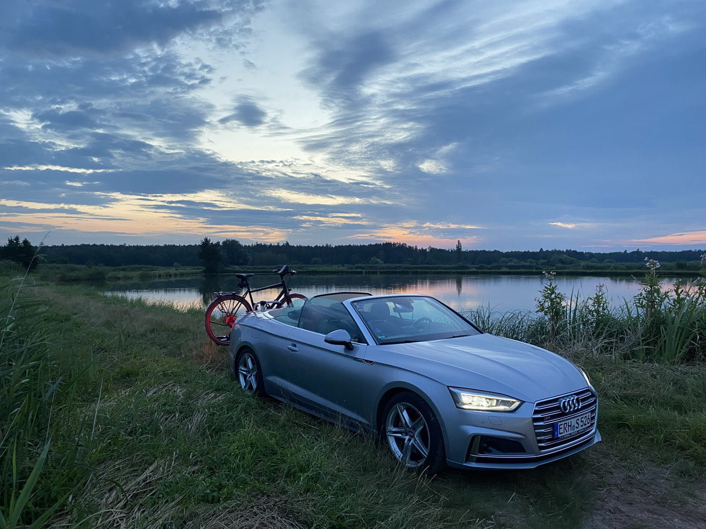
  </a>
  <a href="rottenbach_253996377__photos__807448a7-8b12-4a35-904e-20cc9a1102bd_5ba1b39d-547b-4abd-a81f-c50612a80064.jpg.jpg" class="step-thumb-link" data-gallery="step-253996377" data-index="2" data-media-kind="image">
    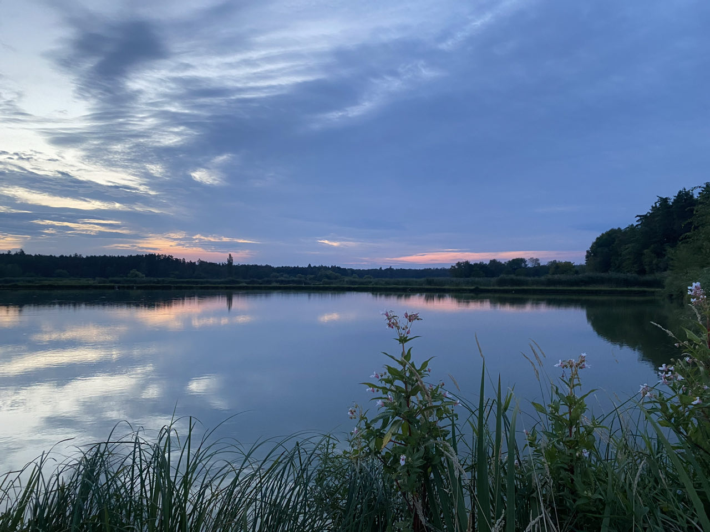
  </a>
  <a href="rottenbach_253996377__photos__4d9acdfa-0bb2-4154-b20f-0b2096aae327_57b45db4-0dd7-49d2-b41c-83e10be8c780.jpg.jpg" class="step-thumb-link" data-gallery="step-253996377" data-index="3" data-media-kind="image">
    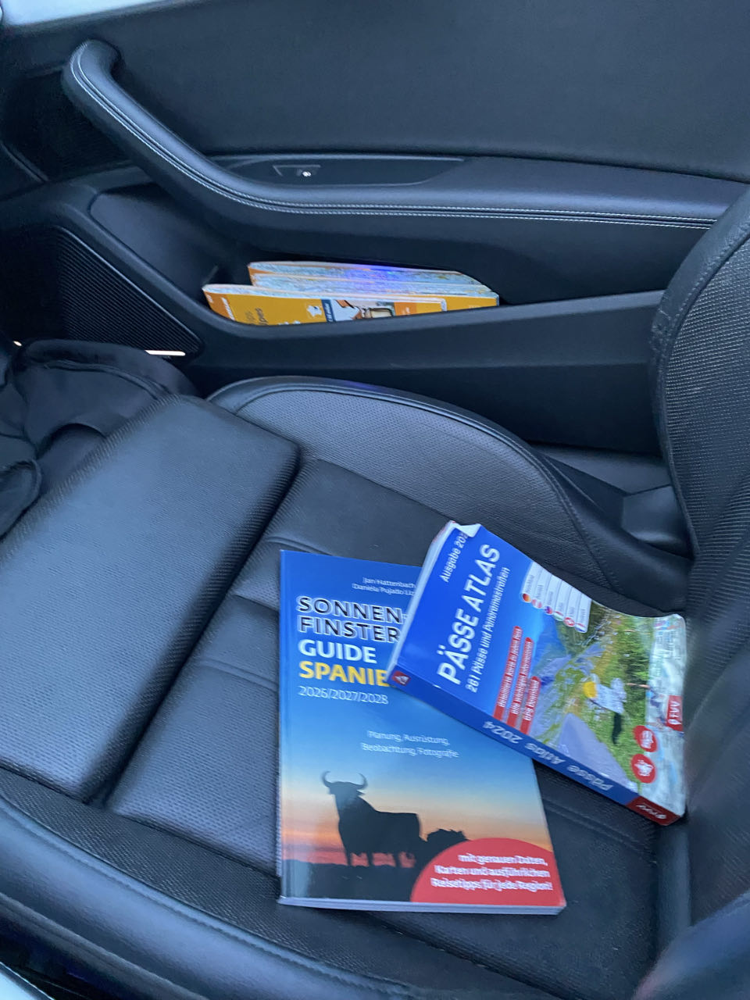
  </a>

#### Etappe: Vorarlberg

Zweites Land für heute: Österreich
Ich bin gemütlich über Landstraßen bis Österreich gefahren, um im Cabrio die Tunnels zu vermeiden. Heute ist auch Ferienbeginn in Bayern und daher auf den Autobahnen viel los. Ich hab davon nichts mitbekommen. 
Kurze Pause mit schönem Ausblick und dann noch eine günstige Tankstelle suchen, bevor es ins nächste Land geht.

  <a href="alberschwende_254106952__photos__32e91964-56fd-4586-ba66-ed2ff074d752_f3e49bac-1e00-4233-8d91-8589573af0e3.jpg.jpg" class="step-thumb-link" data-gallery="step-254106952" data-index="1" data-media-kind="image">
    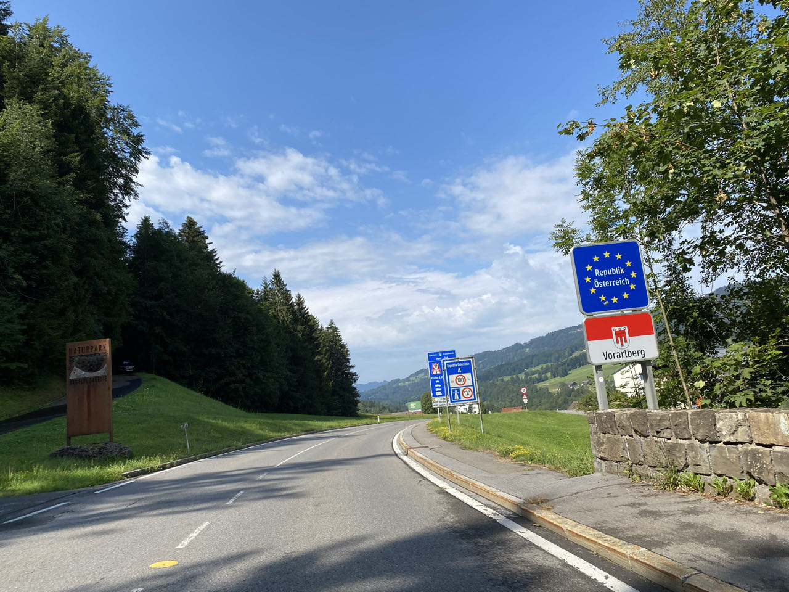
  </a>
  <a href="alberschwende_254106952__photos__29e41049-667e-43d7-a29e-0f627711530a_b64edd8c-158a-4ed5-81ca-c3925d357c41.jpg.jpg" class="step-thumb-link" data-gallery="step-254106952" data-index="2" data-media-kind="image">
    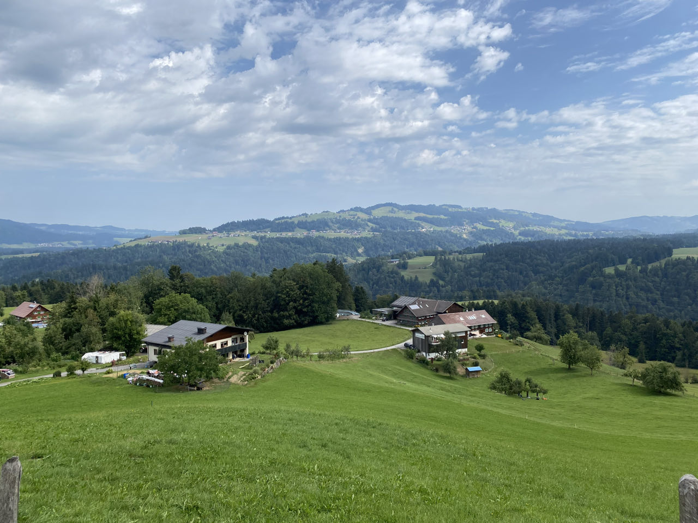
  </a>
  <a href="alberschwende_254106952__photos__ccb52fb0-bb46-4905-9732-175114dd3c2c_6cf58745-7075-4586-9e88-b8ff3955b9af.jpg.jpg" class="step-thumb-link" data-gallery="step-254106952" data-index="3" data-media-kind="image">
    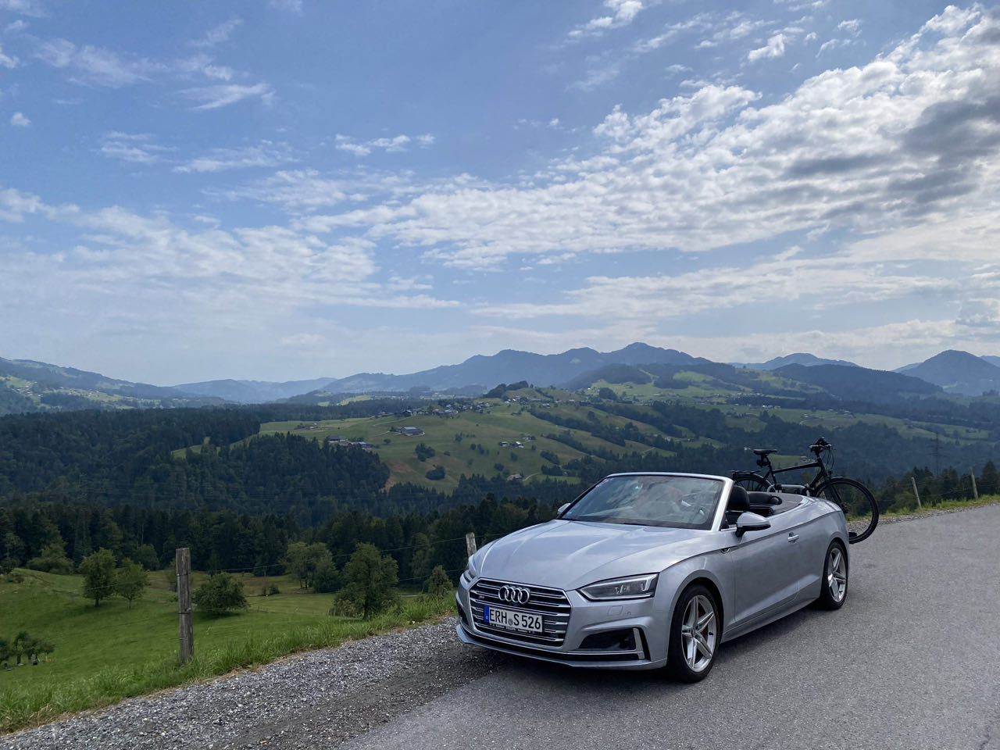
  </a>

#### Etappe: Vaduz

Zweiter Grenzübergang, drittes Land: Liechtenstein
Einen kleinen Abstecher gemacht zum Schloss Vaduz des Fürsten. 
Sehr lohnend ist die Weiterfahrt bergauf nach dem Schloss. Schöne enge kurvige Straßen 🚗🤩
Und so hat sich das kleine Liechtenstein auch auf die Schnelle bei einer Durchfahrt was zu bieten. 
Am Parkplatz kann man sich auch seine Trinkflasche auffüllen.

  <a href="vaduz_254105654__photos__cfeac559-2e48-45be-b326-f8b9fd6856a6_fd2bd3d4-9459-45d1-9caf-5a01840563df.jpg.jpg" class="step-thumb-link" data-gallery="step-254105654" data-index="1" data-media-kind="image">
    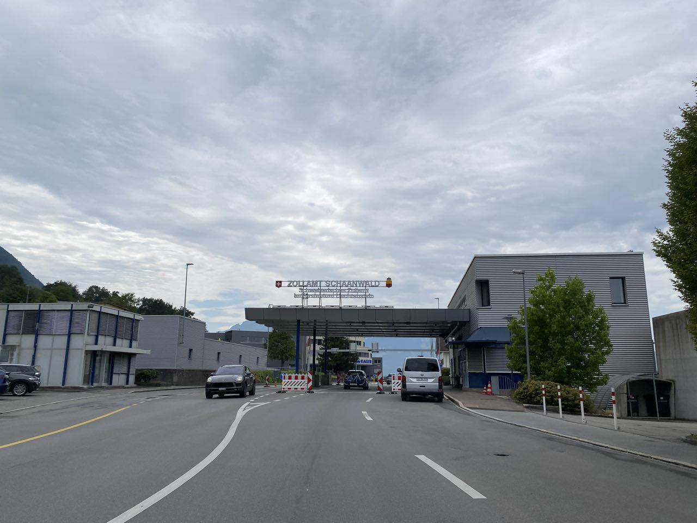
  </a>
  <a href="vaduz_254105654__photos__70d4671c-c3d0-4aa5-8877-2d28a4ff8f89_7f3e835e-8faf-4cc2-9a36-50c90be43122.jpg.jpg" class="step-thumb-link" data-gallery="step-254105654" data-index="2" data-media-kind="image">
    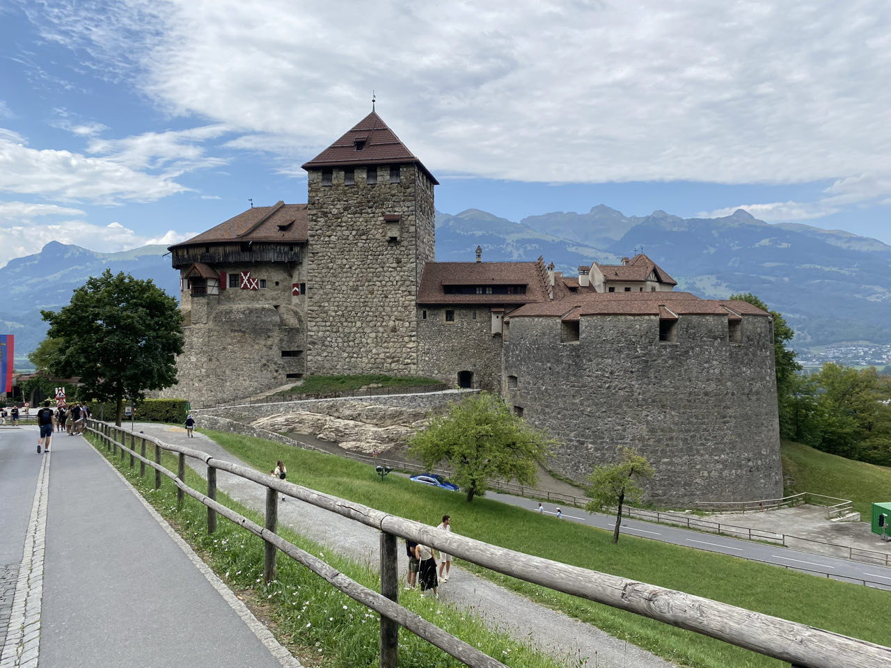
  </a>

#### Etappe: Walensee

Land Nummer vier: die Schweiz

Das Wetter wird immer schöner, jetzt so um 27 Grad. Oh wow, hier in der Schweiz war ich noch nicht. Aber auch hier abseits der Autobahn hat man viel mehr zu sehen. Der Walensee lädt zum Baden ein, glasklares Wasser leuchtet bei dem
Sonnenschein.

  <a href="obstalden_254133476__photos__07e93412-d02e-429d-8608-be3c37844d74_ddbb58b7-d090-4a95-baf7-fa0842a2773b.jpg.jpg" class="step-thumb-link" data-gallery="step-254133476" data-index="1" data-media-kind="image">
    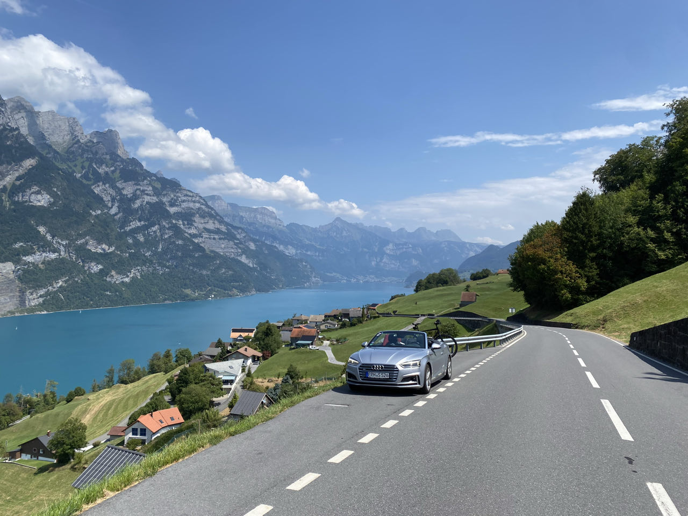
  </a>
  <a href="obstalden_254133476__photos__dc7f39b7-eba0-4149-8e6c-f995161154b5_d5651c6c-b1f5-43b7-8bd3-70dfbd058c57.jpg.jpg" class="step-thumb-link" data-gallery="step-254133476" data-index="2" data-media-kind="image">
    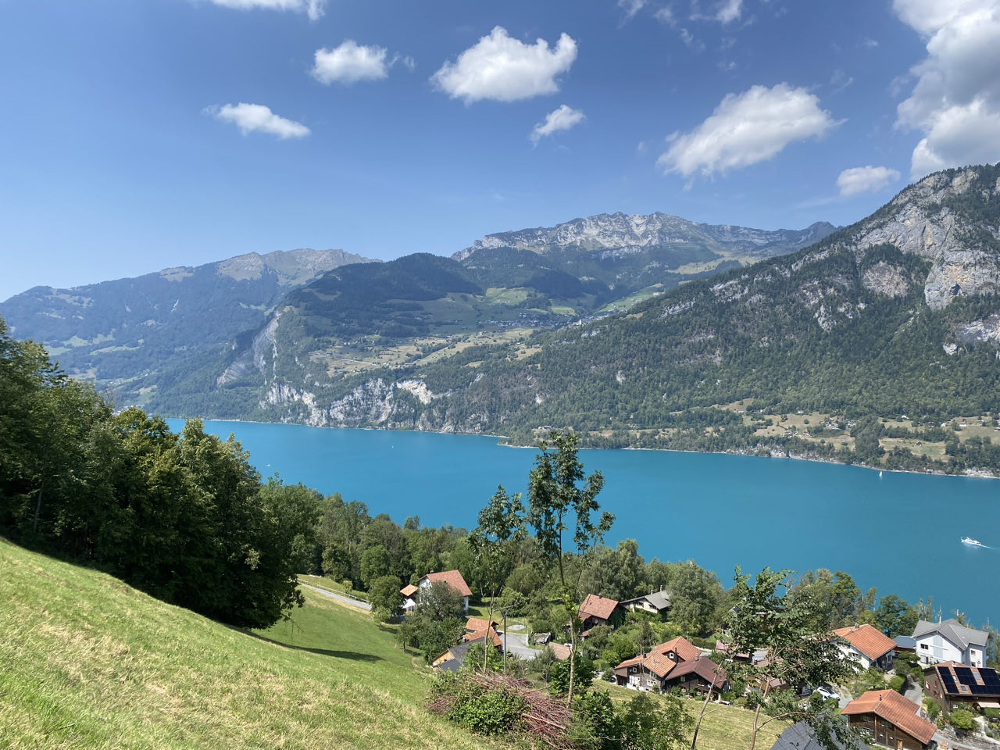
  </a>
  <a href="obstalden_254133476__photos__5152d9c0-15ac-4162-a287-eeee6e08721e_b143961e-4c60-443e-857a-1c3c6e0d3236.jpg.jpg" class="step-thumb-link" data-gallery="step-254133476" data-index="3" data-media-kind="image">
    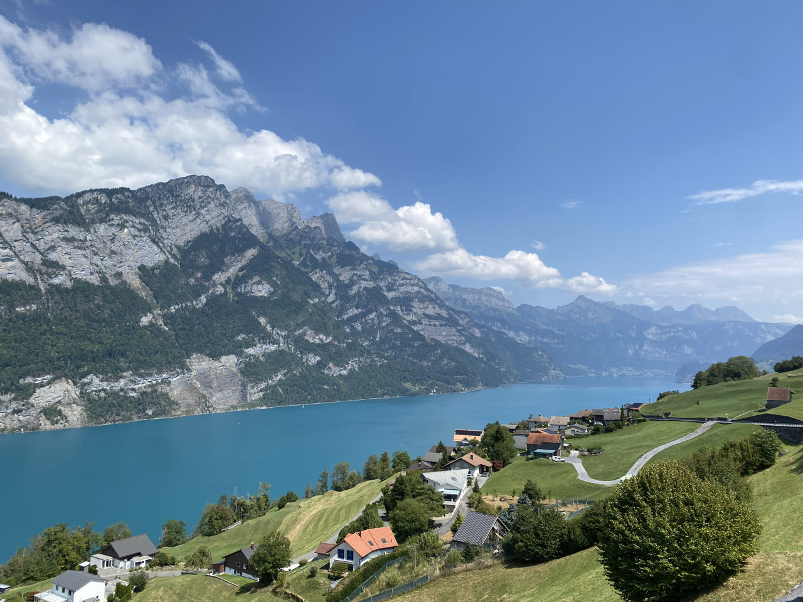
  </a>
  <a href="obstalden_254133476__photos__51a3d071-76dc-4a2f-abb3-b43e991b754b_0f76df0e-6d8a-4d5c-838c-42d3698f86b9.jpg.jpg" class="step-thumb-link" data-gallery="step-254133476" data-index="4" data-media-kind="image">
    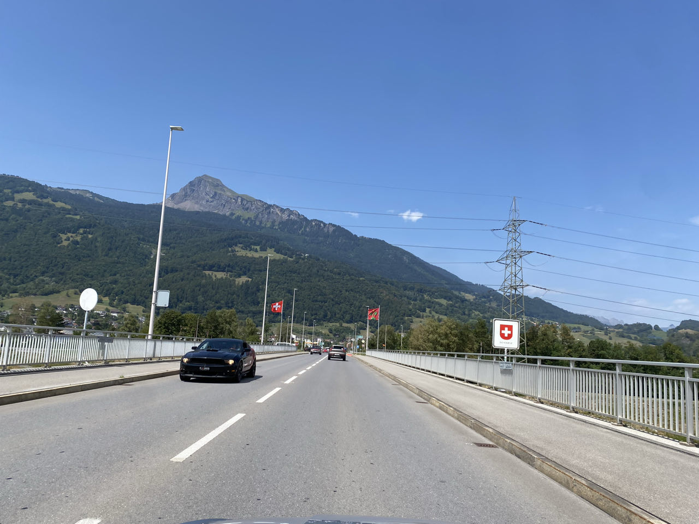
  </a>

#### Etappe: Klausenpass und Unterschächen

Heutiges Etappenziel war das Hotel Alpina in Unterschächen, nachdem ich noch über den Klausenpass gefahren bin. Der war ja allein schon wunderschön mit zwei großen Wasserfällen.

Kurz eingecheckt, dann noch eine Radtour hoch zum Stäubifall, puh am Ende die 15% Steigung mit Schotter musste ich dann schieben, später noch gar laufen. 

Das Wetter zog zu und der Regenradar zeigte schon, dass ich mitten in einer Regenwolke bin. Hm, da war noch nichts zu spüren, aber die Luftseilbahn hoch nach Oberalp im „Schiffli“ hab ich dann nicht gemacht. Es war nicht sicher, ob es auch gewittert, da will ich nicht drin gegrillt werden 😅. 

Also zurück zum Fahrrad gelaufen, da fing es auch an zu regnen. Und wie es schüttete ☔️. Bei nachlassendem Regen dann wieder runter zum Hotel gerollt, unten hat die Sonne (sich eins) gelacht und ein kleiner Regenbogen 🌈 in Richtung ded Wasserfalls war zu sehen. Dann erstmal trockene Sachen angezogen. Morgen wird im Cabrio dann Wäsche getrocknet 🚗🌬️😄

Fazit für den ersten Fahrtag: Landstraße statt Autobahn nehmen, wenn man den Luxus „Zeit“ hat. Heute früh um 7 Uhr schon Obst am Straßenrand gekauft. Viele Stopps für schöne Ausblicke und Fotos anstatt Lärmschutzwände. 

Plan bis zum 4.8. ist es immer schön durch die Alpen 🏔️ bis Cannes.

  <a href="unterschachen_254228744__photos__56c90199-823b-4818-9bf8-da539d93234f_fda6966a-2064-4485-b6fe-2de462d3612f.jpg.jpg" class="step-thumb-link" data-gallery="step-254228744" data-index="1" data-media-kind="image">
    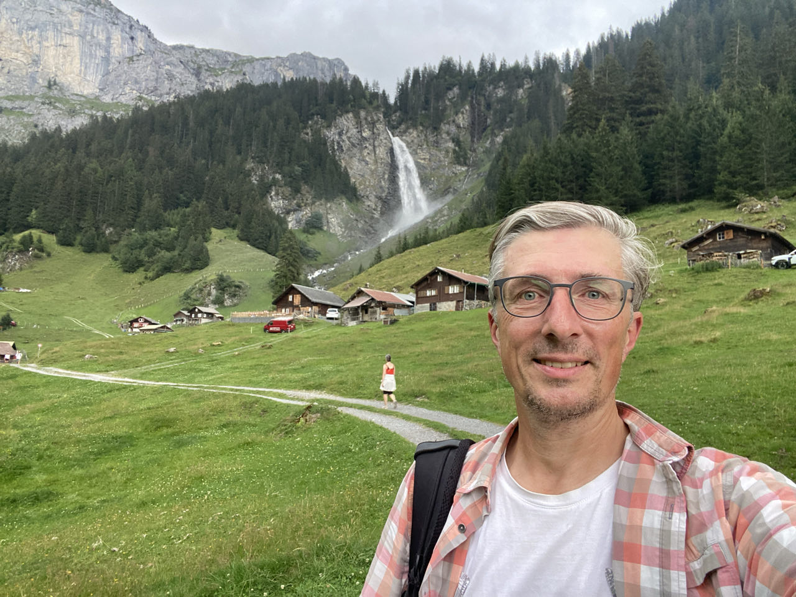
  </a>
  <a href="unterschachen_254228744__photos__e80f6de5-6d52-4629-a269-1a6f23fe62c4_ae03c22a-cf21-4b75-90a1-8084227919dd.jpg.jpg" class="step-thumb-link" data-gallery="step-254228744" data-index="2" data-media-kind="image">
    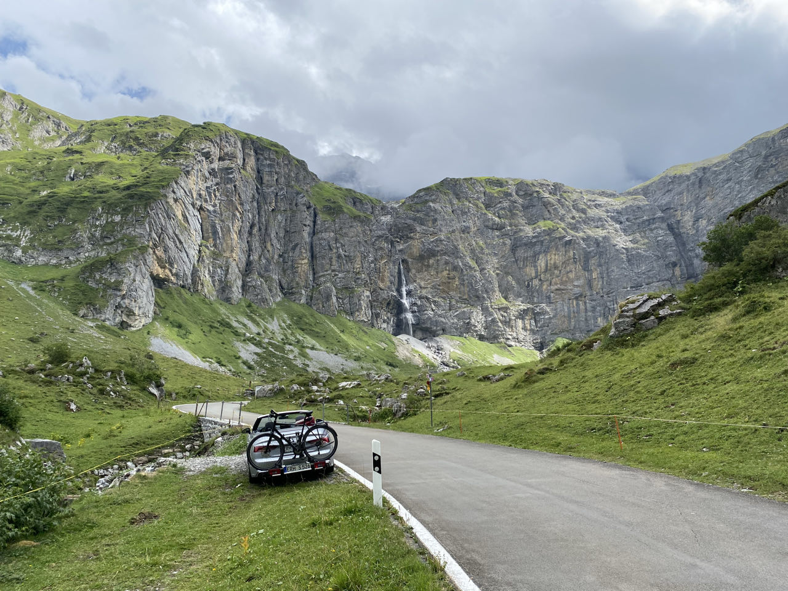
  </a>
  <a href="unterschachen_254228744__photos__51ec395c-2e5b-4954-835c-2563a6c20b03_a38bad76-72d2-4a16-863b-7ee6edb376e2.jpg.jpg" class="step-thumb-link" data-gallery="step-254228744" data-index="3" data-media-kind="image">
    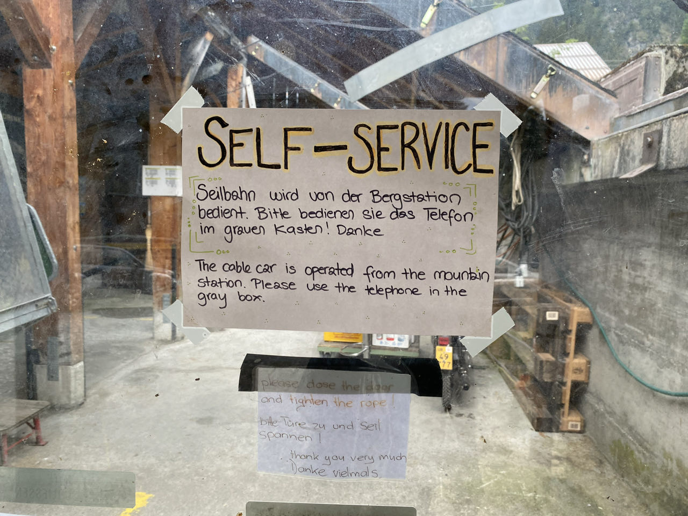
  </a>
  <a href="unterschachen_254228744__photos__44f10bec-b586-44ce-9473-ad79540165e9_8e543570-d000-4f7d-bfdd-e76474855313.jpg.jpg" class="step-thumb-link" data-gallery="step-254228744" data-index="4" data-media-kind="image">
    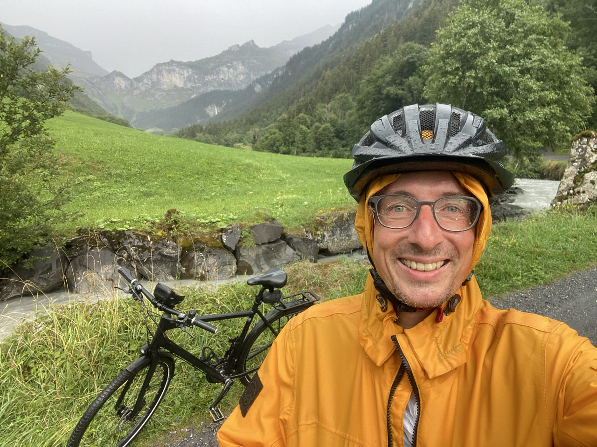
  </a>
  <a href="unterschachen_254228744__photos__8fddc557-67e0-4aac-b034-885d9abbba09_58de79a3-fd3b-4dbd-a07e-fe84d529820d.jpg.jpg" class="step-thumb-link" data-gallery="step-254228744" data-index="5" data-media-kind="image">
    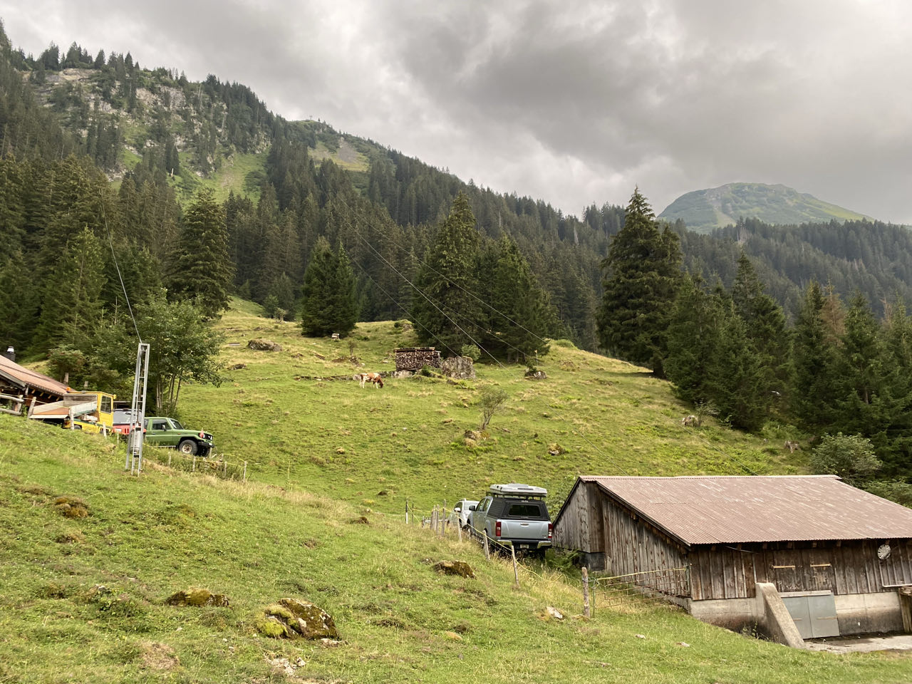
  </a>
  <a href="unterschachen_254228744__photos__9f7afba0-8bb7-46e0-9167-1fd755cb9bf3_35e58681-d66e-4eda-9e15-39494a5f8f20.jpg.jpg" class="step-thumb-link" data-gallery="step-254228744" data-index="6" data-media-kind="image">
    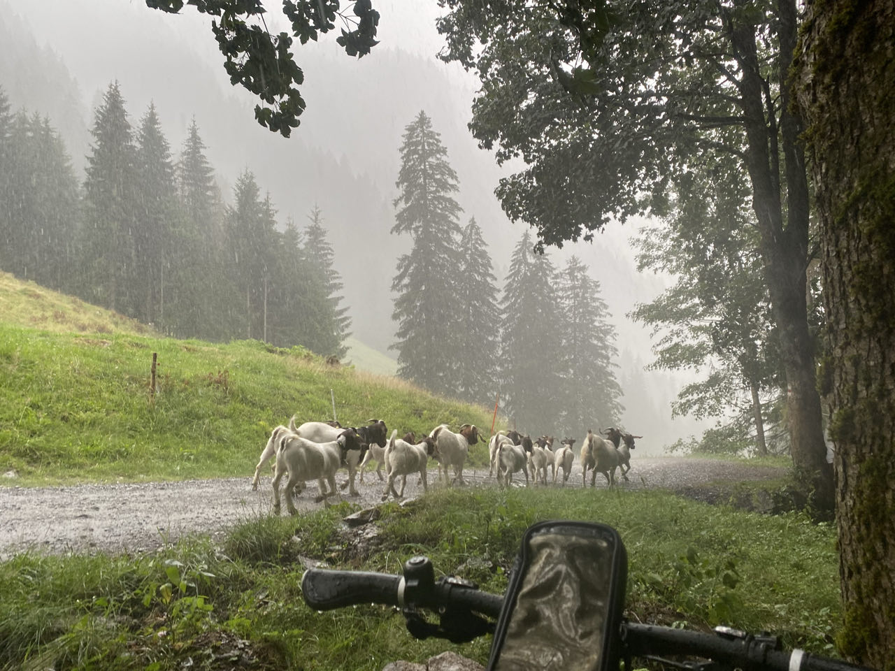
  </a>
  <a href="unterschachen_254228744__photos__1590e39c-923b-4586-a43b-de802331ebe2_35b103c8-9455-490f-80b9-07890a2e25c2.jpg.jpg" class="step-thumb-link" data-gallery="step-254228744" data-index="7" data-media-kind="image">
    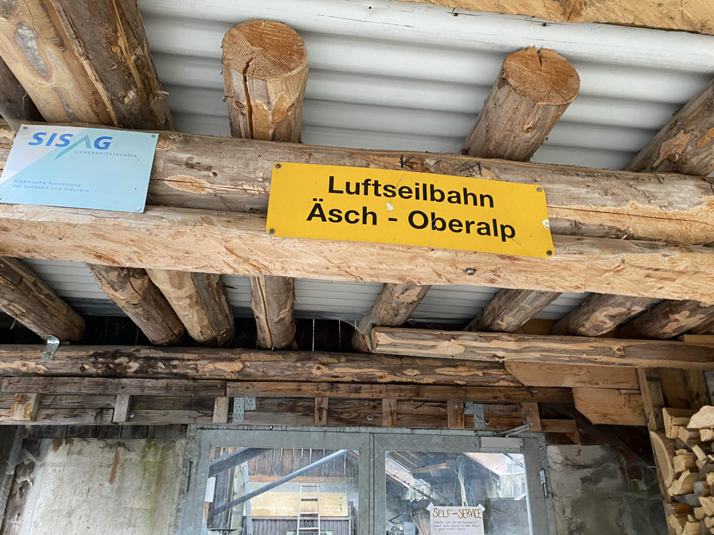
  </a>
  <a href="unterschachen_254228744__photos__43592fc7-116e-433d-a034-c541c58a2851_2a5e06de-6edc-454a-a77c-5b88e3557eb4.jpg.jpg" class="step-thumb-link" data-gallery="step-254228744" data-index="8" data-media-kind="image">
    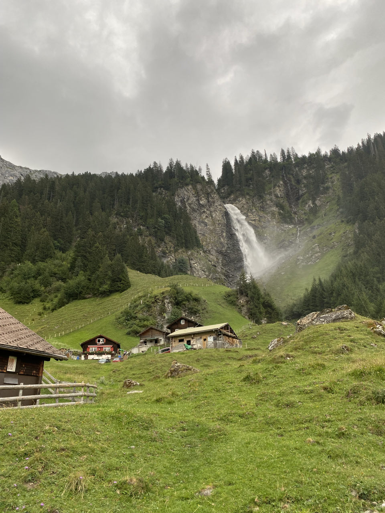
  </a>
  <a href="unterschachen_254228744__photos__3328071a-7f39-461a-b037-f51e12f953ad_1a7b88e1-6717-4a1f-a588-d10a2eb0cc2e.jpg.jpg" class="step-thumb-link" data-gallery="step-254228744" data-index="9" data-media-kind="image">
    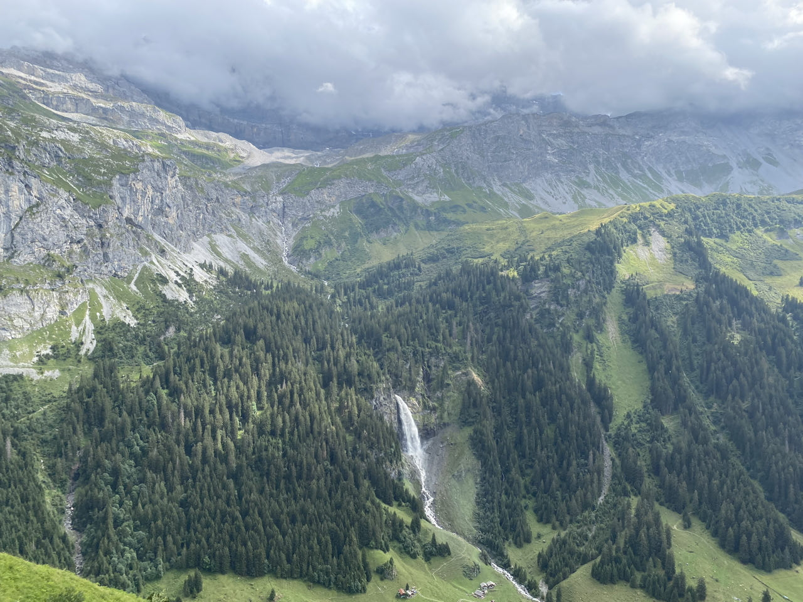
  </a>
  <a href="unterschachen_254228744__photos__34a3b15f-2b1c-4865-8537-be97fd6e854e_12cd008a-c75a-466b-9feb-7e2c01512288.jpg.jpg" class="step-thumb-link" data-gallery="step-254228744" data-index="10" data-media-kind="image">
    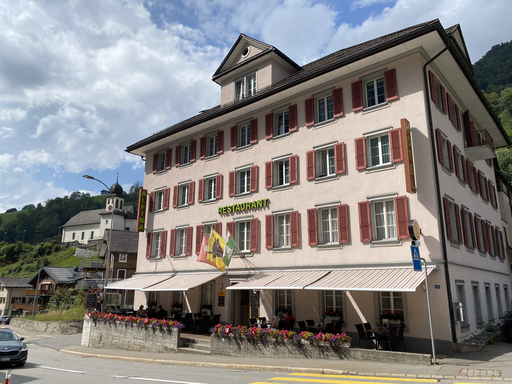
  </a>
  <a href="unterschachen_254228744__photos__1cce034e-11cd-4a0b-99c3-7b024f8537da_10b56c67-27cf-41e0-af40-62d02f439783.jpg.jpg" class="step-thumb-link" data-gallery="step-254228744" data-index="11" data-media-kind="image">
    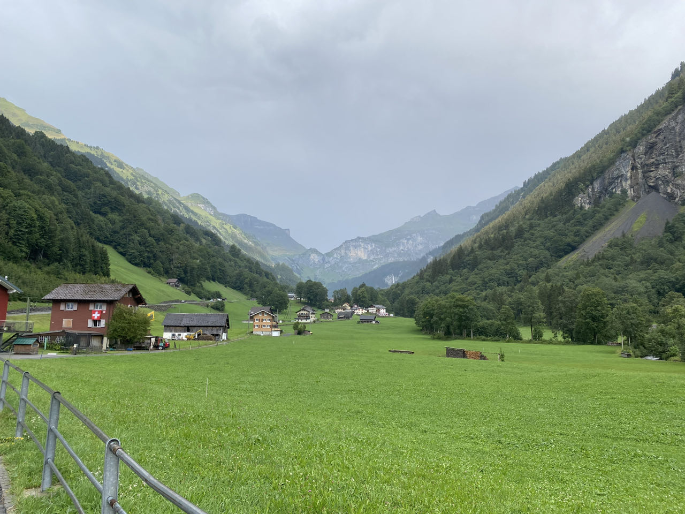
  </a>
  <a href="unterschachen_254228744__photos__eda01d6e-e016-4eee-8335-360b432c4894_0e48707e-5d35-4732-9898-fb208dfdae95.jpg.jpg" class="step-thumb-link" data-gallery="step-254228744" data-index="12" data-media-kind="image">
    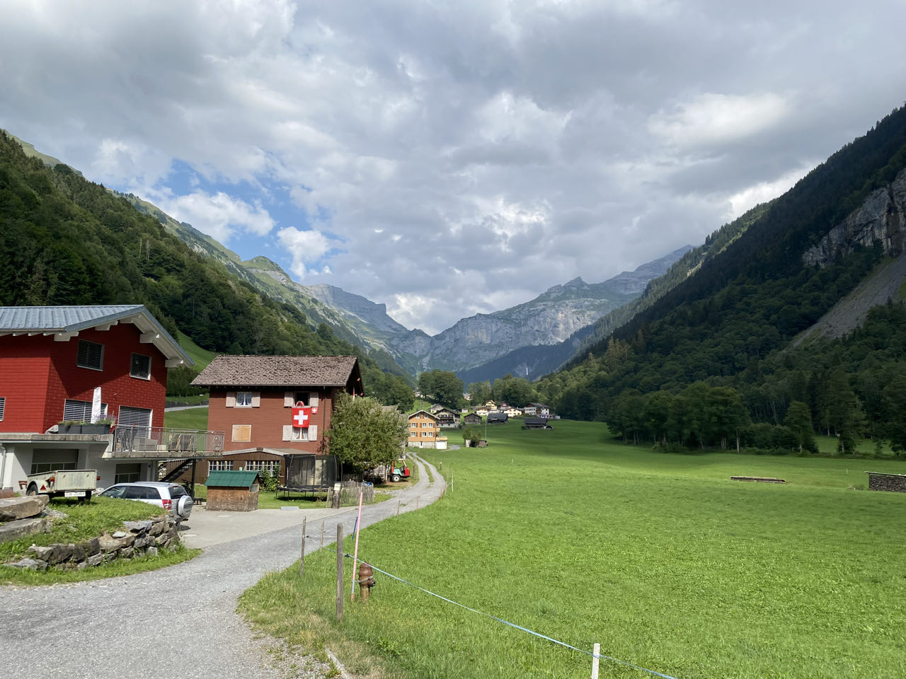
  </a>

### Tag 2 - 02.08.2026

#### Etappe: Oberalp Beizli

Heute Früh aufgewacht. Mir ging die Luftseilbahn noch im Kopf herum. Eigentlich müsste ich das noch nachholen. Ab 7 Uhr fährt die Äsch - Oberalp Seilbahn. Also aufraffen. Das Rösti von gestern Abend war nahrhaft, also noch vor dem Frühstück aufs Fahrrad und nochmal hoch zum Wasserfall geradelt 🚲.  Diesmal sogar ohne Schieben 💪, man darf nur nicht zu schnell machen. 

An der Seilbahn waren Seile abgespannt. Hm gesperrt? 🤔 Ach einfach durch und mal alle Schilder lesen. Keine Öffnungszeiten angeschlagen. Naja, mal das Telefon benutzen und oben durchklingeln. 
Ja hallo? Ich möcht rauffahren. Ja steig ein, kannst nach oben fahren. Nach einem Warnsignal ging es los. 
Was für eine gemütliche Fahrt, ganz ohne störende Masten. Freiluft Feeling, echt wie Cabrio fahren 😄. 
Oben wird in bar bezahlt, gleich für die Rückfahrt. 
Der Ausblick droben war toll auf den Klausenpass. Ich bin dann noch zum Oberalp Beizli gelaufen und hab mir einen Oberalpbeizli Kaffee (wohl mit Schuss) und Rahm gegönnt. Do startet man in den Tag 😄

Dann noch einen Alpkäse eingekauft.  Wieviel willst du? Mit Handgesten wird dann die Größe bestimmt - passt scho 😅

Dann wieder runter mit dem Schiffli - das ist noch viel geiler! Die Seilbahn kippt nach vorne 🎢 🤣

Zurück zum Hotel, aber vorher noch das Verdeck getrocknet. Das Frottetuch vom Audi Eistraining ist echt eine wahre Hilfe 💪

Im Hotel noch gefrühstückt, mit Tannensprösslinghonig 😋. Dann ging es mit 4G (gut Geschlafen, Gekackt, Gelaunt, Gegessen) 😇🤣  los in den zweiten Tag 😜

  <a href="oberalp-beizli_254747815__videos__c71f2b9b-c3be-49db-991f-a681ae35f705_video__thumb.jpg" class="step-thumb-link" data-gallery="step-254747815" data-index="1" data-media-kind="image">
    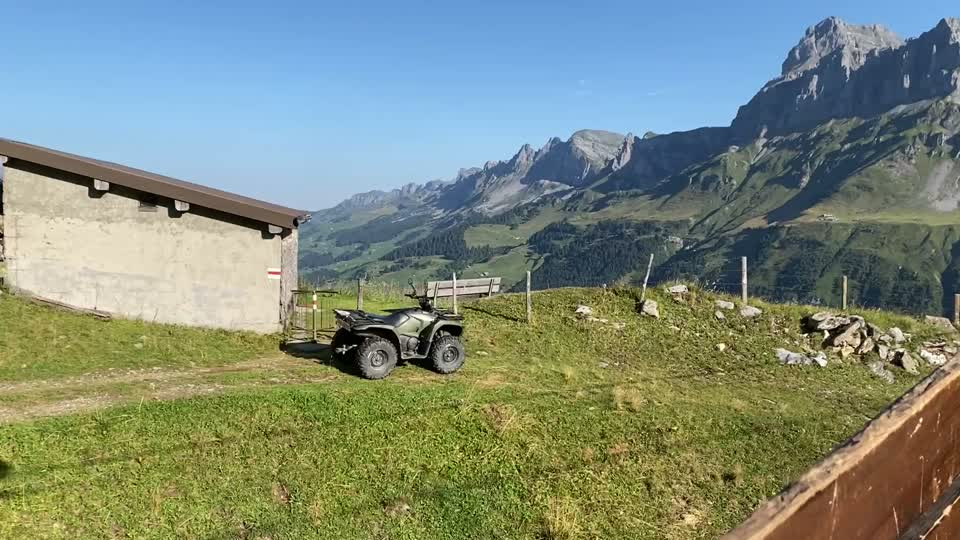
  </a>
  <a href="oberalp-beizli_254747815__photos__7bff119f-bec2-44da-934b-02daa414dfec_f6a7612b-310d-4c5a-9e72-d44257091d1e.jpg.jpg" class="step-thumb-link" data-gallery="step-254747815" data-index="2" data-media-kind="image">
    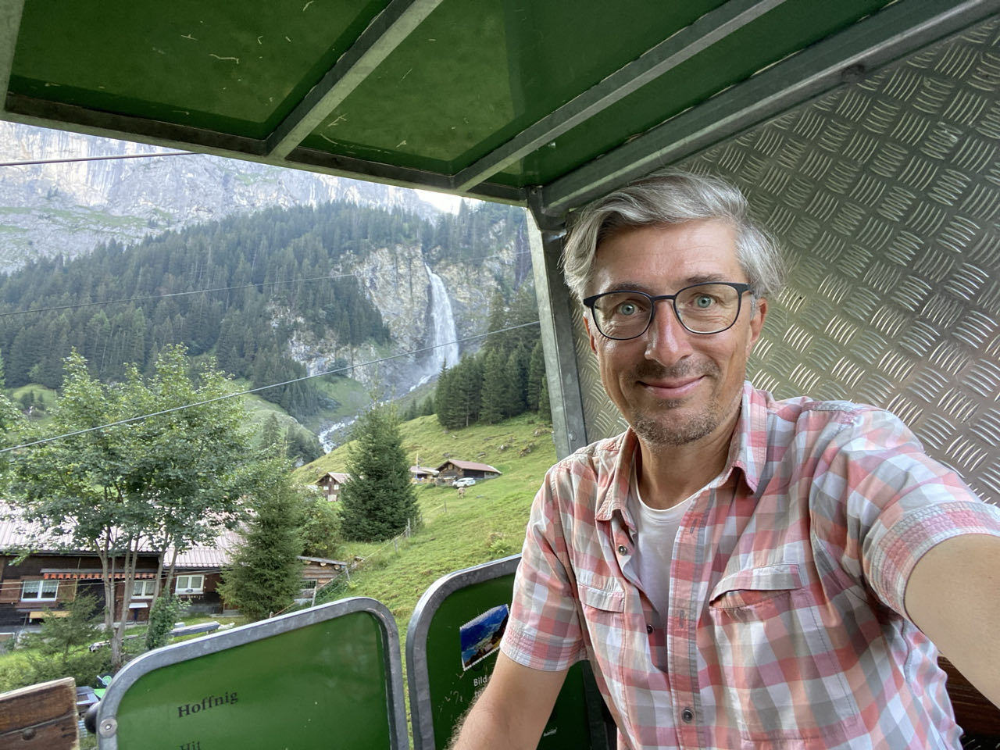
  </a>
  <a href="oberalp-beizli_254747815__photos__07ff67a9-7d69-4265-ac5f-ca906668ab29_dc9d1e34-5c63-4f19-990d-ff9270434153.jpg" class="step-thumb-link" data-gallery="step-254747815" data-index="3" data-media-kind="image">
    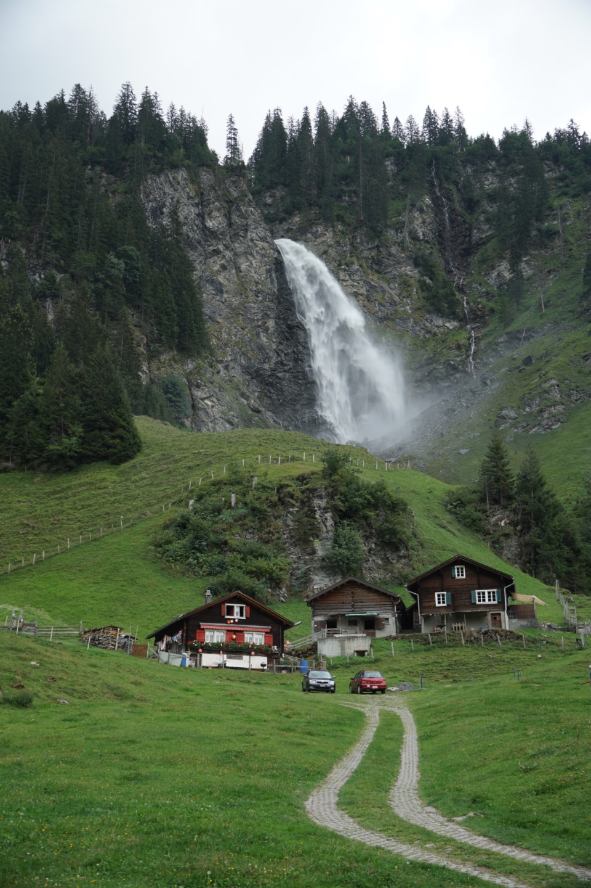
  </a>
  <a href="oberalp-beizli_254747815__photos__6e8d2365-1b66-48a7-afc7-5db6c0160084_d56ee8a7-b458-4fcd-a19b-0af90a98184d.jpg.jpg" class="step-thumb-link" data-gallery="step-254747815" data-index="4" data-media-kind="image">
    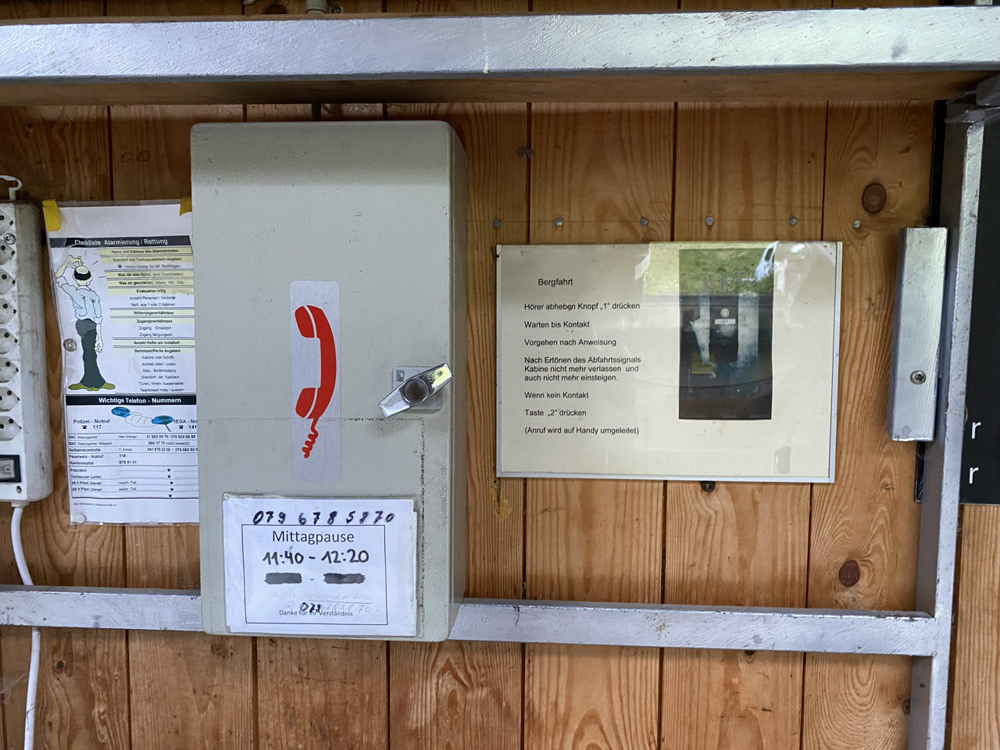
  </a>
  <a href="oberalp-beizli_254747815__photos__bdd32ed4-22b7-4973-a9f0-dcd991d97f1f_ce80a884-7cc0-4362-9bb4-40b389d2ad82.jpg.jpg" class="step-thumb-link" data-gallery="step-254747815" data-index="5" data-media-kind="image">
    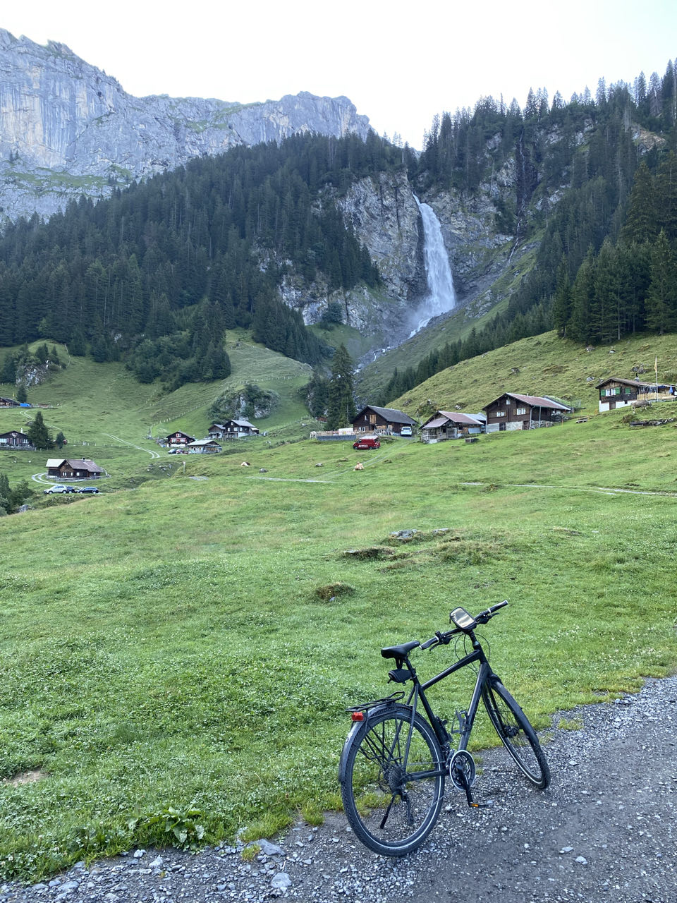
  </a>
  <a href="oberalp-beizli_254747815__photos__4c76cee9-159e-4a3f-bed4-27975da77cfe_c2d24aee-82eb-4d54-8975-5a8a74836d8e.jpg.jpg" class="step-thumb-link" data-gallery="step-254747815" data-index="6" data-media-kind="image">
    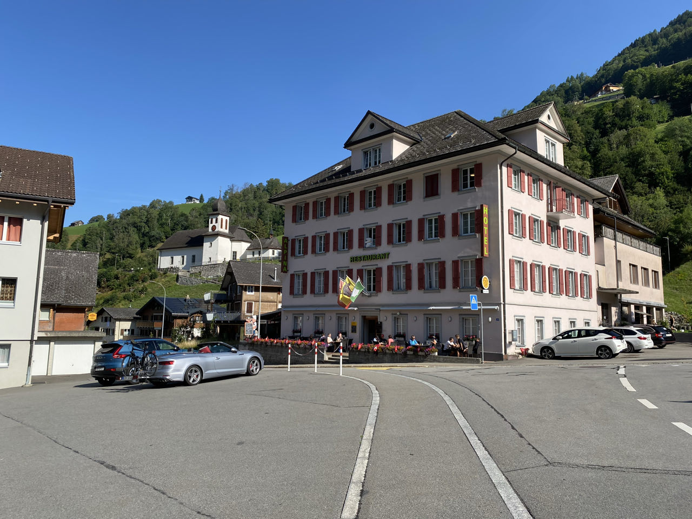
  </a>
  <a href="oberalp-beizli_254747815__photos__1c170522-69a1-4af5-97b5-73ef7e6b5fe2_a76e9a49-8f59-4fd0-8d64-e7b6020779aa.jpg.jpg" class="step-thumb-link" data-gallery="step-254747815" data-index="7" data-media-kind="image">
    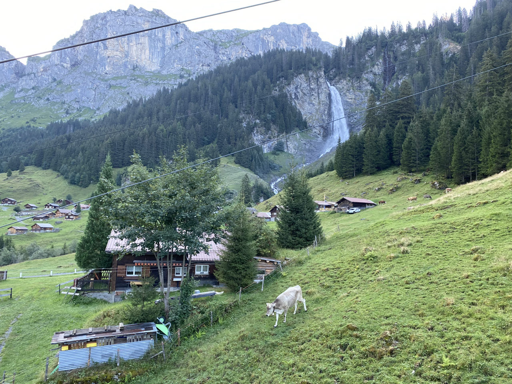
  </a>
  <a href="oberalp-beizli_254747815__photos__cd31b22d-f8e6-4a5d-9abb-b11d526cce6e_846c6a0a-b243-4507-9706-28db9d257ee3.jpg.jpg" class="step-thumb-link" data-gallery="step-254747815" data-index="8" data-media-kind="image">
    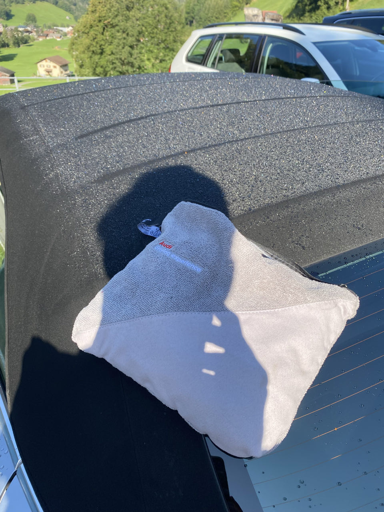
  </a>
  <a href="oberalp-beizli_254747815__photos__349d6242-d8b5-4dfb-bfc3-00b03b99cd34_6fc82a5b-7951-4bca-8172-ccf35c5e104f.jpg" class="step-thumb-link" data-gallery="step-254747815" data-index="9" data-media-kind="image">
    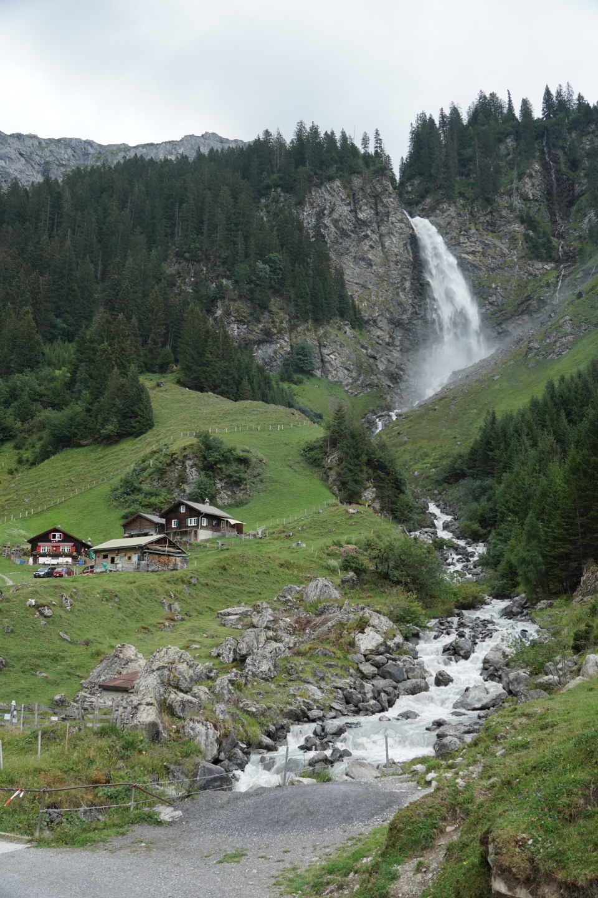
  </a>
  <a href="oberalp-beizli_254747815__photos__754305d4-b04f-4cd3-9ee6-0a5892c5aa28_68b3502f-d553-4256-a07f-36ca9cbd712e.jpg.jpg" class="step-thumb-link" data-gallery="step-254747815" data-index="10" data-media-kind="image">
    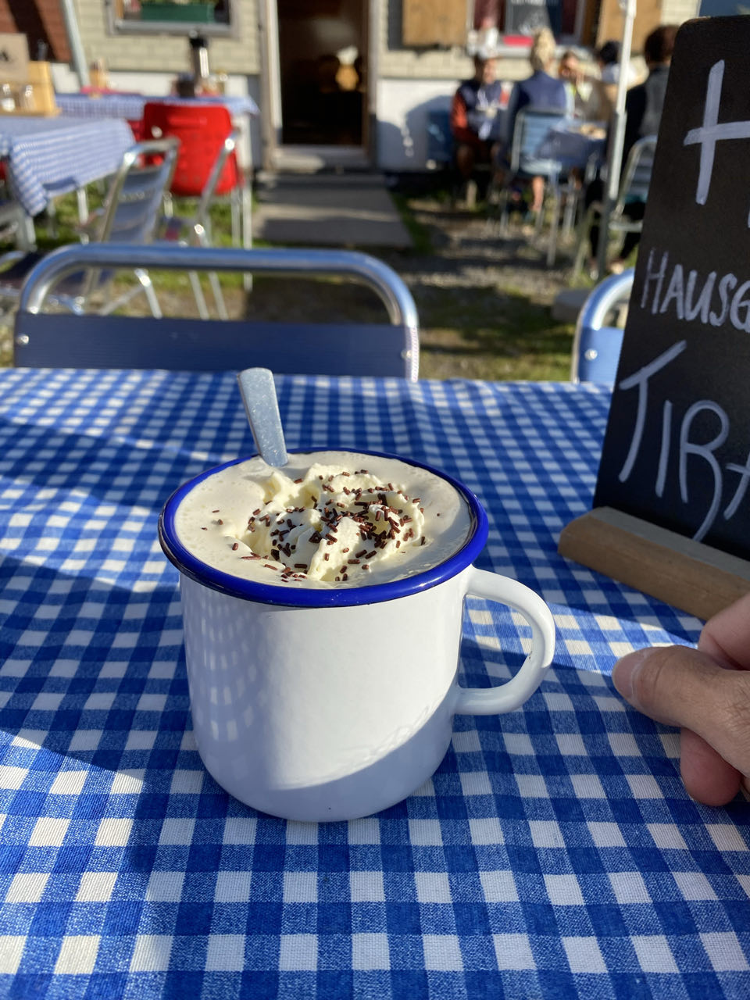
  </a>
  <a href="oberalp-beizli_254747815__photos__7c8a42b6-4086-467b-b410-13c4c26fd919_2e1e04b5-8234-4740-812d-5684ec3576bb.jpg.jpg" class="step-thumb-link" data-gallery="step-254747815" data-index="11" data-media-kind="image">
    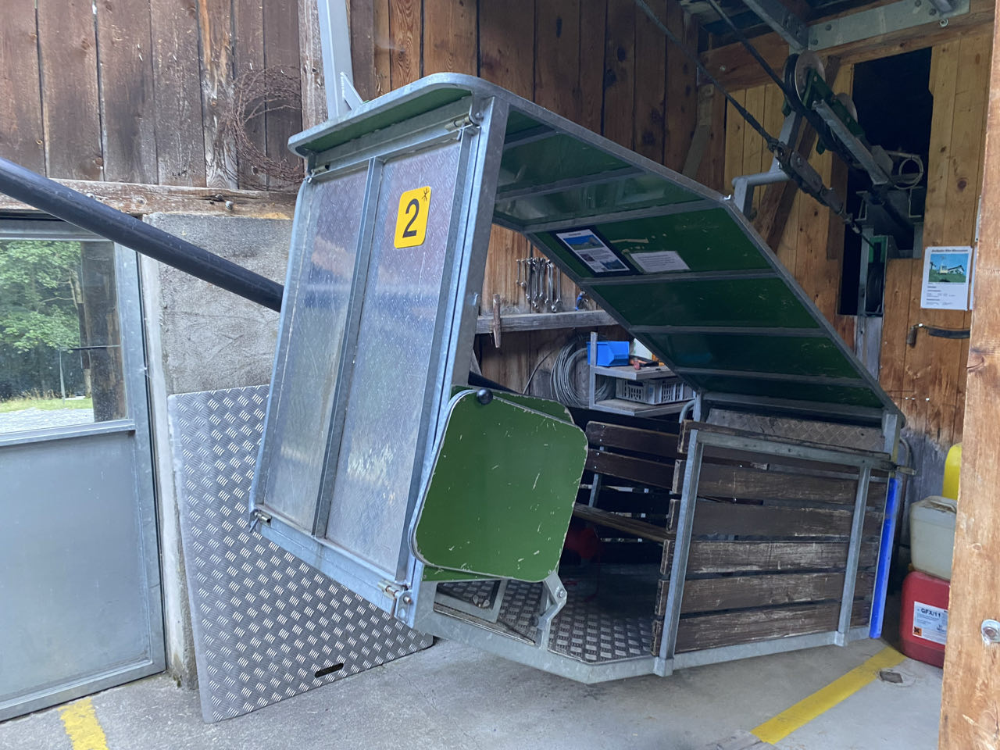
  </a>
  <a href="oberalp-beizli_254747815__photos__9db60251-5ce1-46be-a468-ba450747f683_0c956ac1-1624-49a5-97d5-de3c54f86f6e.jpg.jpg" class="step-thumb-link" data-gallery="step-254747815" data-index="12" data-media-kind="image">
    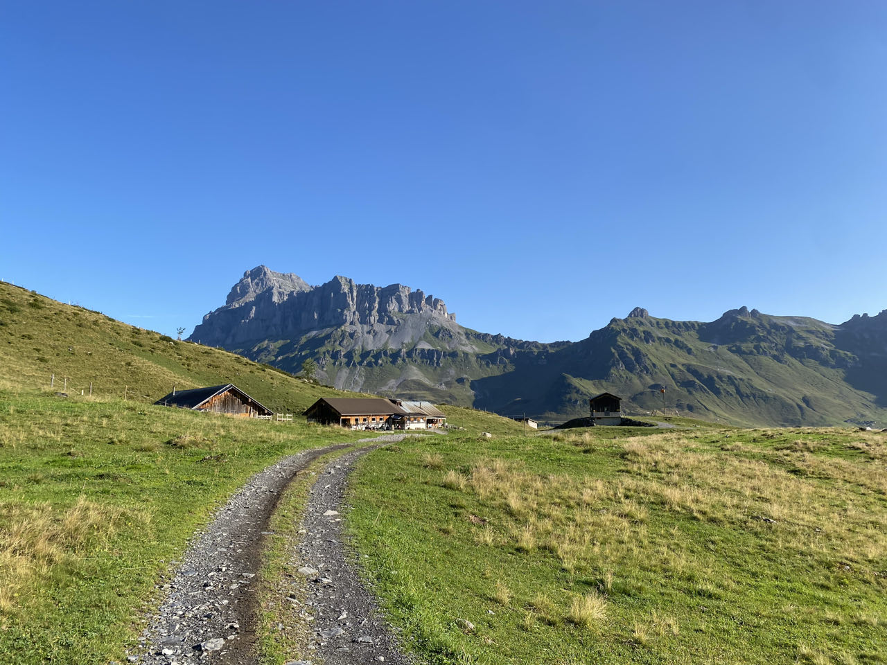
  </a>
  <a href="oberalp-beizli_254747815__videos__c71f2b9b-c3be-49db-991f-a681ae35f705_video.mp4" class="step-thumb-link step-video-link" data-gallery="step-254747815" data-index="13" data-media-kind="video" data-video-poster="oberalp-beizli_254747815__videos__c71f2b9b-c3be-49db-991f-a681ae35f705_video__thumb.jpg?v=1787154863">
    
    Video
  </a>

#### Etappe: Sustenpass

Nach dem morgentlichen Abstecher hoch zur Oberalp ging es gestärkt von Unterschächen weiter. Bei der Fahrt Richtung Andermatt war ich skeptisch, wie es vom Verkehr wird. Reiseverkehr Richtung Süden, Blockabfertigung am Gotthardtunnel? 🤔 Ich bin ja aber auf der Gotthardstraße neben der Autobahn gefahren, da hat man außer sich grüßenden Cabriofahrern nichts bemerkt. Und auf der Autobahn sah es aber auch nicht so schlimm aus.

Nun gut, wohin geht's weiter? Die Schweiz blättert ja das Alpenpässe-Buffet auf 😅. Hoch zum Gotthard, oder über den Furkapass (James Bond Goldfinger)? Kennste beides schon. Also dann doch mal wieder den Sustenpass hochgefahren, und das hat sich auf jeden Fall gelohnt. Strahlendes Wetter, natürlich der übliche Verkehr mit Wohnmobilen, Autos, Radfahrern und schnellen Motorrädern. Aber allen schön Platz lassen und wir kommen alle hoch.

Eine kleine Verschnaufpause mit Blick auf die Gletscher. Auch die Polizei steht hier und dort und wacht über den Verkehr.

  <a href="sustenpass_254844565__photos__1c136195-52ed-47b7-abee-5302178f24d4_abc5ce60-3f4c-4417-97e3-0b82eb2025fa.jpg" class="step-thumb-link" data-gallery="step-254844565" data-index="1" data-media-kind="image">
    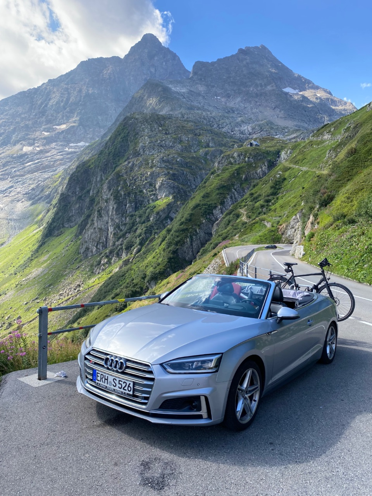
  </a>
  <a href="sustenpass_254844565__photos__62ec15aa-670d-432b-bddf-8156adefb00a_75414419-ebc3-49ee-a3eb-fb77d5aa2bf4.jpg" class="step-thumb-link" data-gallery="step-254844565" data-index="2" data-media-kind="image">
    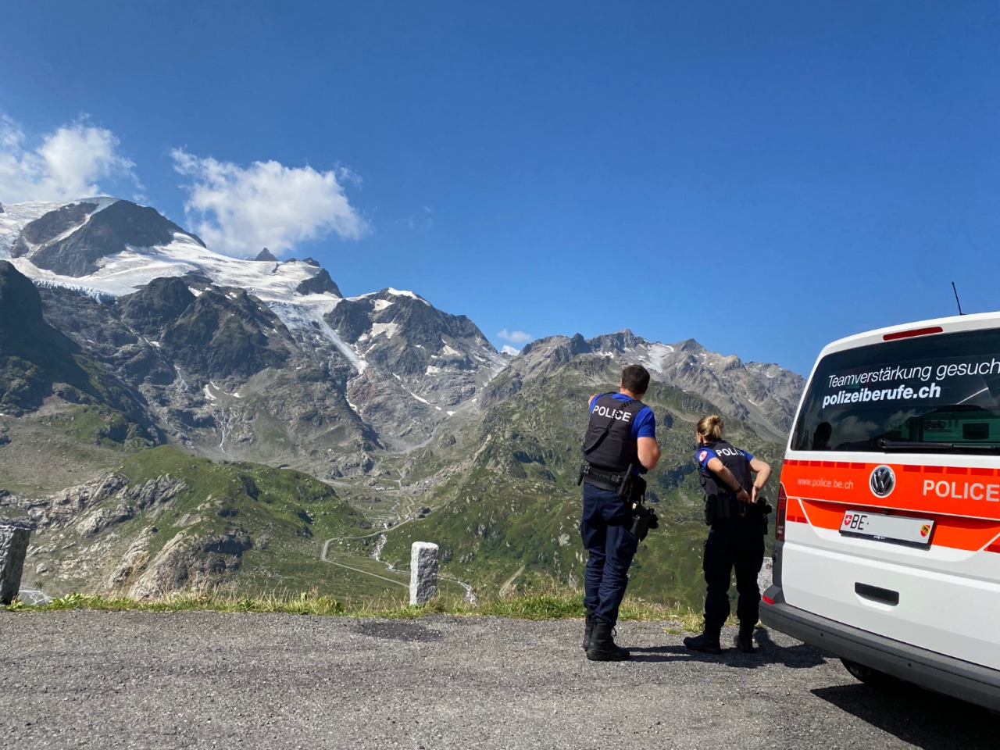
  </a>
  <a href="sustenpass_254844565__photos__fd7bdd91-f347-460c-88e4-f841e87d717f_6d5acbc8-2325-4507-ab6b-ac280ae36d06.jpg" class="step-thumb-link" data-gallery="step-254844565" data-index="3" data-media-kind="image">
    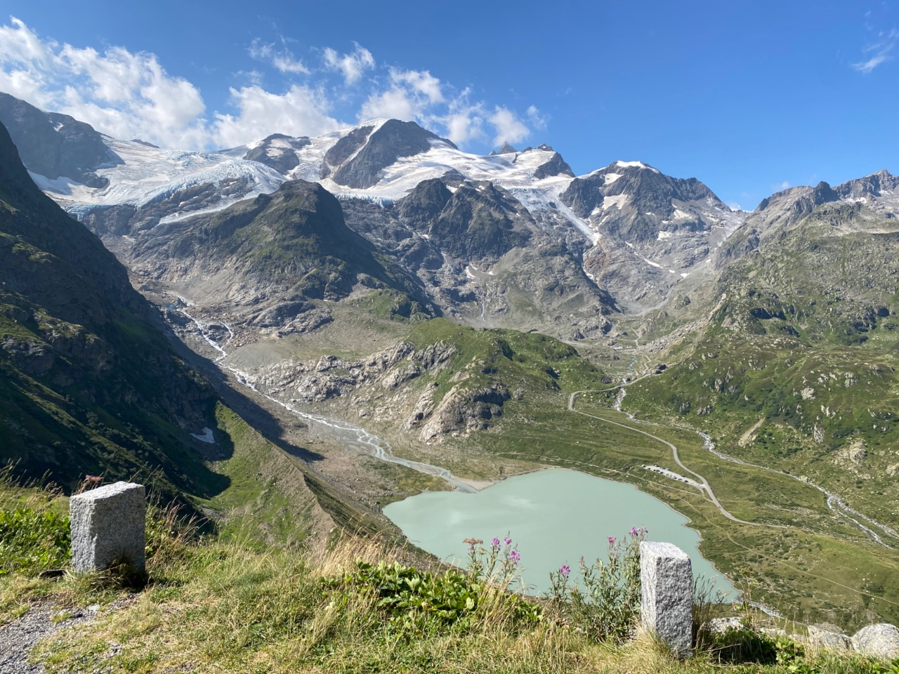
  </a>
  <a href="sustenpass_254844565__photos__ba81cbab-dd47-4564-94c2-7419811dce2e_60bcfccb-c76a-43c7-b474-e4fdfe20f1cb.jpg" class="step-thumb-link" data-gallery="step-254844565" data-index="4" data-media-kind="image">
    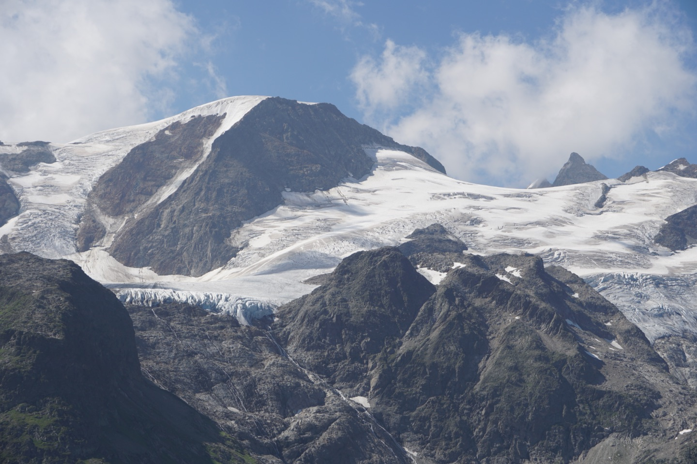
  </a>
  <a href="sustenpass_254844565__photos__487c4f2d-07a8-4850-aabf-c8f608de8f3d_30c817b3-c67e-423e-a392-0e8cea8eebe3.jpg" class="step-thumb-link" data-gallery="step-254844565" data-index="5" data-media-kind="image">
    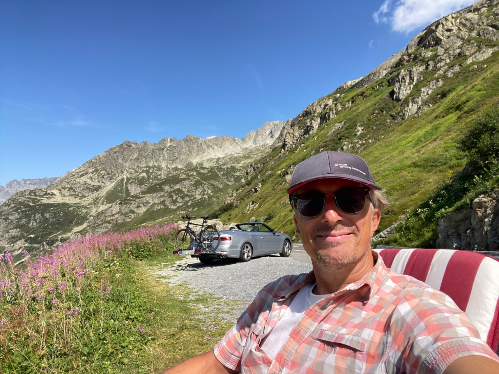
  </a>
  <a href="sustenpass_254844565__photos__b12bcf55-5b7e-44e1-8ca5-c6968e125036_18999743-f7e3-4553-afcc-725f60f1fd08.jpg" class="step-thumb-link" data-gallery="step-254844565" data-index="6" data-media-kind="image">
    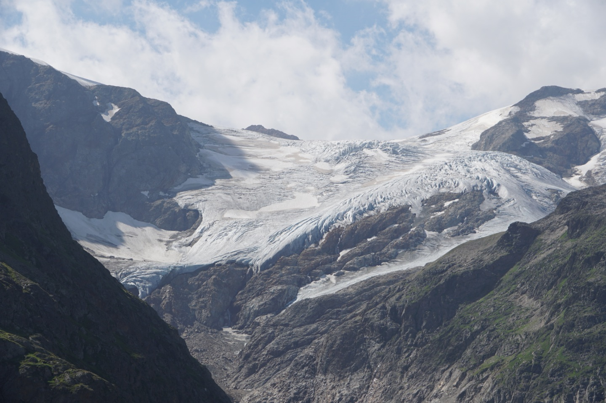
  </a>
  <a href="sustenpass_254844565__photos__d1f10595-ee7b-4c71-bdc0-e336e16efcbd_12d99aa7-5d2f-499d-ab3c-efd6dab3f3b9.jpg" class="step-thumb-link" data-gallery="step-254844565" data-index="7" data-media-kind="image">
    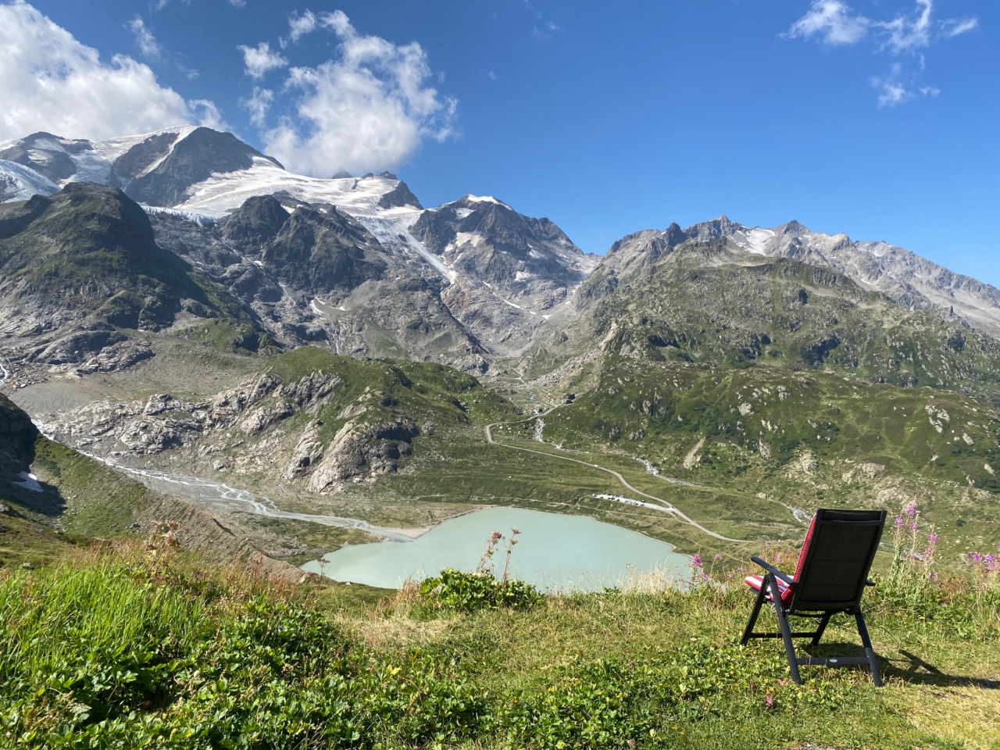
  </a>
  <a href="sustenpass_254844565__photos__44997bc7-e2e6-4f47-953c-a87d457400a9_008b7eb6-74b6-42ca-bcf8-3733d422a0a8.jpg" class="step-thumb-link" data-gallery="step-254844565" data-index="8" data-media-kind="image">
    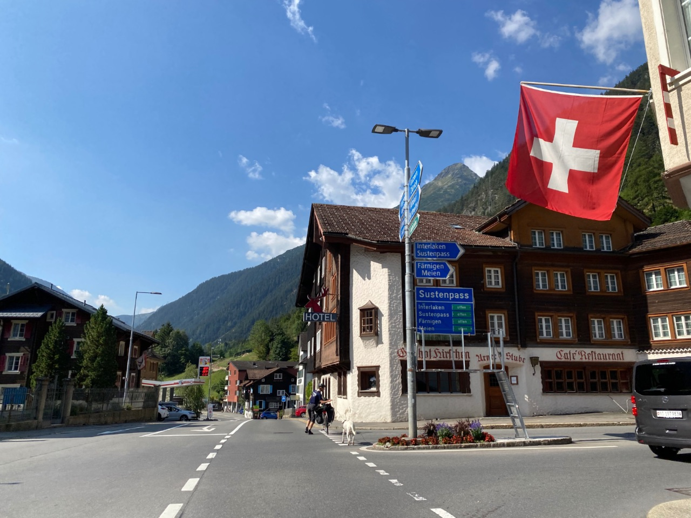
  </a>

#### Etappe: Grimselpass

Und damit ich weiter südlich komme ging es gleich weiter über den Grimselpass. 

Bei der Auffahrt waren ein paar Tunnels, aber ich hab auf die Beschilderung rechts geachtet. Das haben wir ja auf Madeira zu genüge geübt 🤣.

Einmal war der alte Weg für Autos gesperrt, aber weiter oben war nur ein 34t Schild - gut da bin ich deutlich drunter, also darf man da fahren. Oha - Kopfsteinpflaster, Felsüberhänge und sonst kein Auto unterwegs. Für ein kurzes Stück kann man hier noch neues entdecken. 

Weiter droben am Stausee noch zum Grimsel Hospiz geschaut. Heute waren auch zig Peugeot 205 zu sehen. Ich hab dann mal nachgesehen, die fahren die europ.raid https://europraid.fr durch 20 Länder Europas - hm, das sieht auch nach einer feinen Route aus 😅

Nach der Passhöhe hat man einen schönen Blick auf den Furkapass mit dem alten Hotel Belvedere.

  <a href="grimselpass_254848516__photos__74435665-9574-4ea3-9f23-072bf61ffd39_a9403c0f-70ec-4ce8-a2cf-cf61f472dad1.jpg" class="step-thumb-link" data-gallery="step-254848516" data-index="1" data-media-kind="image">
    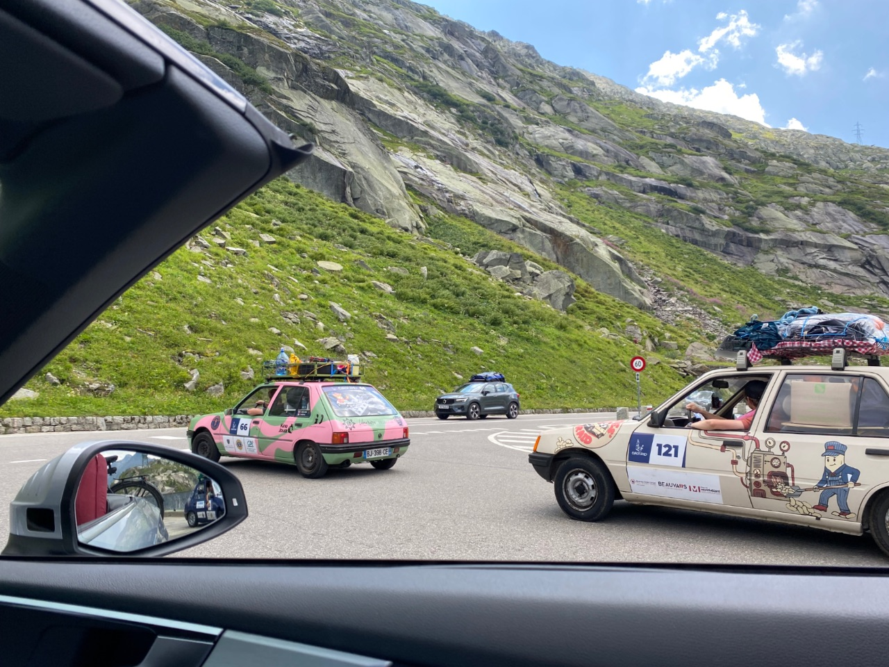
  </a>
  <a href="grimselpass_254848516__photos__632641ed-ea62-43f5-a820-41c937c16f6b_a0282271-952c-461a-a37d-d70d1cb92bef.jpg" class="step-thumb-link" data-gallery="step-254848516" data-index="2" data-media-kind="image">
    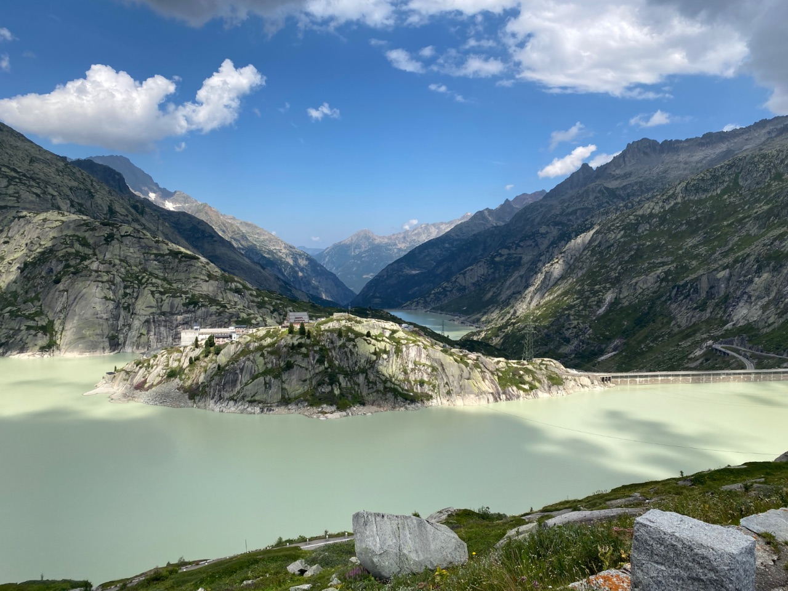
  </a>
  <a href="grimselpass_254848516__photos__b179240c-1074-4953-aff6-0d66baa2102f_74021555-ccb9-4641-8dbe-814f6989ac7d.jpg" class="step-thumb-link" data-gallery="step-254848516" data-index="3" data-media-kind="image">
    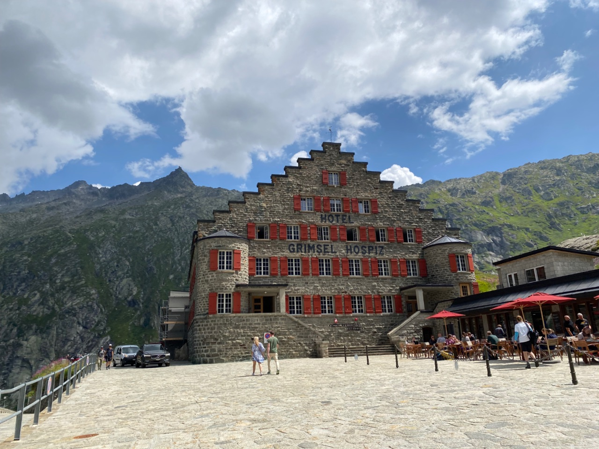
  </a>
  <a href="grimselpass_254848516__photos__a2fd4eee-0898-4cf1-85df-d2040781c87b_5a0c2a0c-3336-412b-8589-5000513b5ca7.jpg" class="step-thumb-link" data-gallery="step-254848516" data-index="4" data-media-kind="image">
    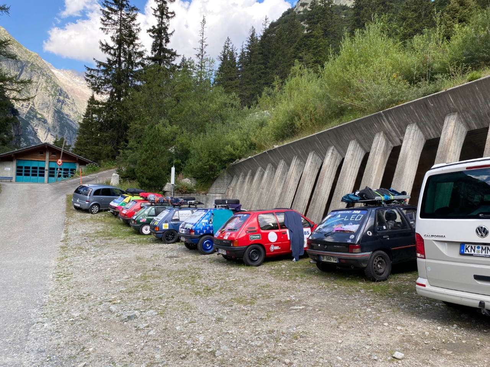
  </a>
  <a href="grimselpass_254848516__photos__e844b239-efb8-4647-9f1e-4c70a4c0e613_468d8170-85cc-494c-8c8d-ecd41f7c7618.jpg" class="step-thumb-link" data-gallery="step-254848516" data-index="5" data-media-kind="image">
    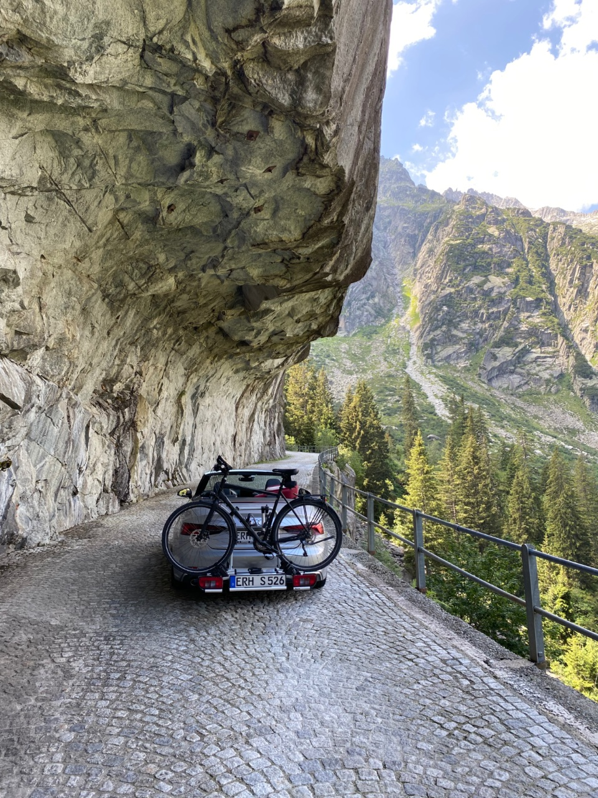
  </a>
  <a href="grimselpass_254848516__photos__d541f729-5f5f-4941-ac09-597ec204c188_3604d242-4647-437a-9300-09805c931ef0.jpg" class="step-thumb-link" data-gallery="step-254848516" data-index="6" data-media-kind="image">
    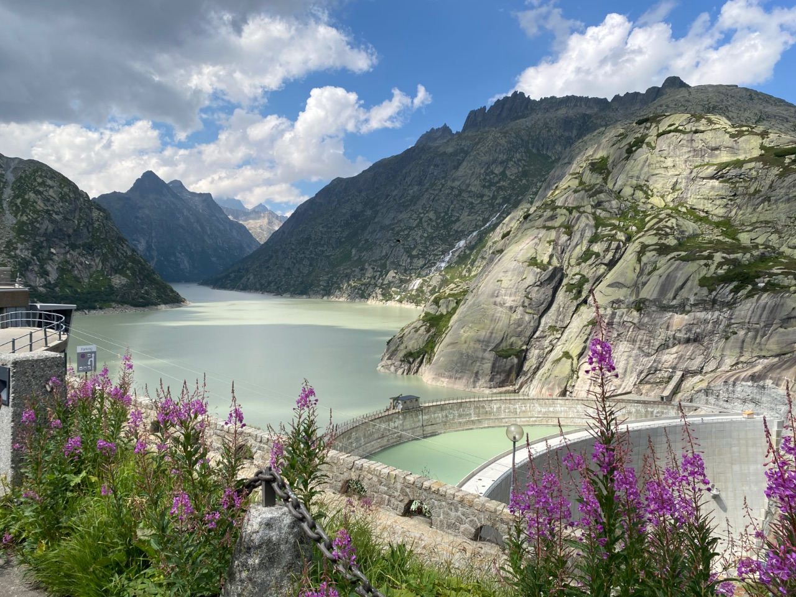
  </a>
  
  
  

#### Etappe: Rhonetal

Nach zwei spektakulären Bergpässen war das Rhonetal was zum runterkommen. Gemütlich entlang cruisen, puh bis zu 36 Grad, aber die Klimaanlage kühlt von unten 🧊😎.

Nächstes Ziel ist der große Sankt Bernhard.

  
  
  
  

#### Etappe: Großer Sankt Bernhard Pass

Die Tankanzeige meldete sich schon bei der Auffahrt, aber bis nach Italien müsste ich es noch schaffen.

Es war dann schon kurz nach 17 Uhr oben am Pass. Also wird es Zeit, sich eine Unterkunft zu suchen. 

Nur ein paar schnelle Fotos und weiter geht es in Land Nummer fünf: Italien 🇮🇹

  
  
  
  
  
  
  

#### Etappe: Arvier

Vom großen Sankt Bernhard geht es runter nach Aosta. Dort einen kurzen Tankstopp und weiter zur Unterkunft in Arvier.

Das Aostatal muss man auch auf der Landstraße fahren, da sind ja überall Burgen und Schlösser und Kirchen. Die Autobahn geht vielfach durch Tunnels und man bekommt davon gar nichts mit.

Das kleine Hotel in Arvier war eine gute Anlaufstelle. Ein Wasserfall gleich nebenan, und beim Abendessen sah ich da noch ein Verkehrschild mit grünem "offen" - hm, wo geht's denn da noch entlang?

  
  
  
  
  
  
  
  

#### Etappe: Valgrisenche

Gut gestärkt im Restaurant (sehr leckere Pasta, ein Steak mit Gemüse, ein Moretti und ein Espresso für 21€) bin ich dann noch die SR 25 hochgefahren. Schöne kleine Straße.

Beim Stausee war dann Schluss, aber der Blick war so toll und es war total ruhig. Also nochmal hinsetzen und den ereignisreichen Tag sacken lassen.

Ja und dann zwei Telefonate geführt. Dieter in Mauretanien 🏜️ und Jonas in Australien 🦘 - so "klein" ist die Welt 🌍🤣.

Die Sterne kamen raus und dann ging es viel zu spät zurück ins Hotel, am Campingplatz ganz leise vorbei 🤫

  
  
  
  
  
  
  
  

### Tag 3 - 03.08.2026

#### Etappe: Colle San Carlo

Heute war um 9:45 Start vom Quartier in Arvier 🤣 auf zu weiteren Bergpässen und ein weiteres Land. 

Zuerst ging es noch im Aostatal weiter westlich, direkt auf das Mont Blanc Massiv zu - sehr beeindruckend 🏔️🤩

Links hoch zum Colle San Carlo nach Arpy hinauf. Oben waren die Wanderparkplätze alle voll, es gibt dort auch einen Ausblick auf den Mont Blanc. Hab ich dann aber ausgelassen. Ein kurzer Fotostop für ein zwei Bilder haben es auch getan. 

Dann auf zum kleinen Sankt Bernhard Pass.

  
  
  
  
  
  
  
  
  
  

#### Etappe: Kleiner Sankt Bernhard Pass

Die Straßen hoch zum Kleinen Sankt Bernhard Pass sind sehr eng und kurvig. Oben auf der Passhöhe habe ich mein sechstes Land erreicht: Frankreich 🇫🇷

Nach zwei Bergpässen heute erst mal eine kleine Pause mit tollem Blick ins Tal. 

Und man sieht, diese Strecken sind für die Tour de France bunt markiert 🚴🏻‍♂️

  
  
  
  
  
  
  
  
  
  
  
  

#### Etappe: Col de l‘Iseran

Und gleich geht es weiter zum höchsten asphaltierten Alpenpass auf 2770hm, dem Col de l‘Iseran. 
Die karge Landschaft oberhalb der Baumgrenze ist wieder ein ganz anderer Eindruck der letzten Tage. 

Der Hunger kam und so gibt es erst mal eine europäische Brotzeit: Aprikosen 🍑 noch aus 🇩🇪, den Alpkäse aus der 🇨🇭, Schinkenspeck aus 🇮🇹 und ein Brot aus 🇫🇷 😜

Danach noch einen Espresso ☕️

Frisch gestärkt suche ich jetzt nich einen Aufkleber für die Windschutzscheibe.

  
  
  
  
  
  
  
  
  
  
  

#### Etappe: Col du Mont Cenis

Nach dem Col de l‘Iseran fing es an zu regnen. Ich musste aber weiter Strecke machen und bin über den Col du Mont Cenis wieder Richtung Italien unterwegs. 

Dieser Pass ist scheinbar für Oldtimer sehr beliebt 😅

Der Kampf mit den Schauern. Verdeck trocknen und aufmachen, kurze Zeit später der nächste Schauer 😅

  
  
  
  
  
  
  
  

#### Etappe: Susa

Kurze Durchfahrt durch Susa in Richtung Oulx, um
Dort weiter zurück nach Frankreich zu fahren. Das Verdeck ist wieder offen 💪

Bei Susa waren wir vor zwei Jahren, hoch zum Colle de Sommeiller mit Dieters Grenadier 🤩, auf 3000hm ein kühles Bad nehmend 🤣 und heimwärts die dreimalige Fahrt über den San Bernandino 😜😅

  
  
  
  

#### Etappe: Briançon

Bis Briançon war wieder Regen. Aber die Sonne spitzte wieder heraus. Also nochmal das Verdeck trocknen und in der Abendsonne noch bis zum
Hotel, ein paar Regentropfen bei offenem Dach störten nicht. 

Heute hab ich genug Strecke gemacht 🇮🇹🇫🇷🇮🇹🇫🇷😜, um morgen bis Cannes zu kommen und auf dem Weg noch etwas anzuschauen. 

Das Hotel Ice Rock ist auch ein schöner Glückstreffer. Viele locals, das Essen super lecker, alle sehr freundlich und hilfsbereit. Die Musik aus Brasilien, das erinnert mich an unsere Musik-Streams auf Madeira 🇵🇹🏎️🤣

Morgen geht es ans Meer 🌊 das wird eine schöne Abwechslung nach vier Tagen Alpenüberquerung 🏔️

  
  
  
  
  
  
  
  
  

### Tag 4 - 04.08.2026

#### Etappe: Briançon

Die Nacht war gut, der Fluss Durance rauschte schön konstant bei offenem Fenster. 
Ein kleines gutes Frühstück im Hotel, dann ging es um 8 Uhr bereits los. 
Ein kleines Kuriosum hab ich beim losfahren gesehen. Was ist das? 
Scheint eine Brücke für ein Wasserrohr zu sein. Die haben da glaube ich Wasserkraftwerke. 

Heutiges Ziel ist Cannes, und auf dem Weg noch über ein paar Bergpässe und durch Schluchten zu fahren. 

Der Col de la Bonette mit seinem Rundkurs bis auf 2800hm wäre auf dem Weg 🤔😜😅

  

#### Etappe: Cime de la Bonette

Ich bin den Col de la Bonette ja schon letztes Jahr gefahren. Komplett „aus versehen“ und bei totaler Dunkelheit 🙈. Ich wollte von Cannes nach Italien, aber halt nicht einfach die Autobahn. Das Navi sagte, das dauert ungefähr gleich lang. Als ich im Lichtkegel dann was von 2800m sah, war ich sehr, sehr skeptisch. Aber oben ausgestiegen war so ein sternklarer Himmel, da hatte ich spontan mein erstes Milchstraßenfoto gemacht. Schnell noch überlegt, was ich alles einstellen muss 🤣. Das Nachtfoto 🌌 zur Erinnerung, war wie gesagt letztes Jahr. Heute alles bei Tageslicht ☀️

Fotos vom Gipfel sahen ja sehr karg aus, von daher war ich jetzt nicht super erpicht darauf, den Pass nochmal zu fahren. Toppen, meinte ich, kann ich das Nachtfoto nicht. 

Aber weit gefehlt, die Auffahrt von Norden ist so abwechslungsreich, so viele verschiedenen Gesteinsformationen - wow! Tagsüber sieht man halt etwas von der Umgebung und nicht nur die Fahrspur im Scheinwerferlicht 🤣

Der Rundkurs geht bis auf 2802m hoch, und ich bin dann die sechzig Meter noch bis zum Gipfel hoch. Super windig, aber sehr toll. Und wenn man genau hinschaut, findet man hier auch viele verschiedene bunte Blumen. 🌺

Auf der Abfahrt erst noch eine Brotzeitpause, bevor ich die Details zur Weiterfahrt plane.

  
  
  
  
  
  
  
  
  
  
  
  
  
  
  
  
  

#### Etappe: Col de la Couillole

Auf dem Weg zu den roten Schluchten musste ich einmal scharf rechts abbiegen. Aber sofort war man auf wenig befahrenen Straßen.
Oha, ein Hinweisschild, dass am Samstag hier die Tour de France vorbeigeht und die Straße für ein paar Stunden gesperrt ist. 🚴‍♂️🇫🇷
Oh nach wenigen Kurven bot sich aber auch schon wieder ein Spektakel, der Col de la Couillole, den hatte ich gar nicht auf dem Radar, war einfach der schnellste Weg ins andere Tal.

  
  
  
  
  
  
  

#### Etappe: Gorges du Cians

Und dann ging es zu einer der roten Felsschluchten, den Gorges du Cians. Davon habe ich spektakuläre Bilder gesehen, nur muss man dazu auch aus dem Auto aussteigen :-)
Ich habe ja mein Fahrrad dabei, also konnte ich die Tunnels schneller ansteuern, um die alten Wege abfahren, die schon zum Teil ziemlich verfallen sind. 
Wow, das sind in die Felsen gehauene kleine Wege, kleine Tunnels oder halbseitig zum Bach offen. Da kommt das Sonnenlicht schön von oben herein. 🤩
Ich bin da auf und abgeradelt und habe noch eine Brotzeit gemacht, weil es ja doch immer heißer wird, wenn man sich dem Meer nähert 😅

Aber so langsam muss ich ja nach Cannes, damit alles für das Feuerwerk noch klappt...

  
  
  
  
  
  
  
  
  
  
  
  
  <a href="gorges-du-cians_255586317__videos__039351d1-53d3-4962-aa53-c7c4fe20b903_video.mp4" class="step-thumb-link step-video-link" data-gallery="step-255586317" data-index="13" data-media-kind="video" data-video-poster="gorges-du-cians_255586317__videos__039351d1-53d3-4962-aa53-c7c4fe20b903_video__thumb.jpg?v=1787154858">
    
    Video
  </a>

#### Etappe: La Mer 🌊

Mein Navi hat mich ausgetrickst und während der Fahrt nach Cannes doch die Route bis am Flughafen in Nizza vorbei. Naja, wenn ich nun schon in Meeresnähe weiterfahre, dann bekomme ich Lust, endlich mal die Füße wieder ins Meer zu stecken. An einem kleinen Bahnhof habe ich im Stop-and-Go-Verkehr eine Unterführung für Fußgänger gesehen. Also auf einen der Parkplätze der Supermärkte, und schnell mal rübergelaufen.

Und ja, man ist vorsichtig, aber dennoch macht man sich gleich mal die kurze Hose nass, weil die nächste Welle doch noch höher schwappt 🌊💦🤣. Super, auch wenn mich das auch wieder Zeit bis nach Cannes gekostet hat, das war den kurzen Zwischenstopp wert! Zum Füße abwaschen suchte ich meine kleine Flasche - ui die war durch den Luftdruck auf Meereshöhe ziemlich gequetscht 😜

Also weiter in den Stadtverkehr um und in Cannes.

  
  
  
  
  
  

#### Etappe: Cannes

Puh, der Verkehr bis zu einem der Tiefgaragen war mal wieder sehr zäh. Aber ich hatte ja heute schon so viel schönes erlebt, und das Feuerwerk beginnt ja erst um 22 Uhr. Jedoch muss man sich sputen, will man sein Auto noch wo parken. Abends sieht das nämlich ganz ganz anders aus, da stehen sehr lange Schlangen vor den geschlossenen Schranken.

Aber so um 18 Uhr hatte ich meine Sachen aus dem Auto, was ich für den Abend und eine Nacht brauche. Dann zum Hotel eingecheckt. Ein schnuckelig kleines Hotel in einem Hinterhof. Sehr zentral gelegen, ich war in 2 Minuten oben auf der Burg und konnte die Touristenströme weitgehend umlaufen.

Naja, dann nochmal frisch gemacht, Foto und Stativ mitgenommen und etwas zum Abendessen gesucht. Auch hier etwas abseits, nicht die überlaufenen Touristenmeilen. Eine kleine Stärkung und dann ging es um halb neun so langsam vor zur Promenade.

Ja und das Feuerwerk Festival ist wie immer erstklassig. Das lohnt sich jedes mal. Traumhaft, mal laut, mal leise und ruhig mit den Farben spielend, immer synchron zur untergelegten Musik. Die Trikolore war am Anfang schon sehr beeindruckend. La Mer 🎶 spielte auch mal, oh wie schön.

Oh mann, so gehen vier Tage Alpentour in Cannes super gelaunt zuende. Das wäre für sich ja schon eine Reise wert gewesen. Aber es geht ja noch weiter 🤣

  
  
  
  
  
  
  
  
  
  
  
  
  
  <a href="cannes_255587990__videos__3e73eccb-488b-4dff-93e0-448d7b21e665_video.mp4" class="step-thumb-link step-video-link" data-gallery="step-255587990" data-index="14" data-media-kind="video" data-video-poster="cannes_255587990__videos__3e73eccb-488b-4dff-93e0-448d7b21e665_video__thumb.jpg?v=1787154854">
    
    Video
  </a>

### Tag 5 - 05.08.2026

#### Etappe: Cannes

Ein kleiner Morgenspaziergang in Cannes bei angenehmen Temperaturen und noch leeren Straßen. 
Die Stadt wird wieder blitzblank gesäubert. Die Patisserie gleich am alten Hafen hat auch schon geöffnet 😋
Ich hab noch keinen Plan, was heute das nächste Ziel ist, ausser erst mal frühstücken ☕️🥐

  
  
  
  
  
  
  
  
  
  
  
  
  
  

#### Etappe: Pointe de l‘Aiguille

Wenn ich nach Cannes komme, halte ich gerne an dieser kleinen Badebucht. Heute waren die Parkplätze oben schon alle belegt, aber am Straßenrand war noch Platz. Ein kleines erfrischendes Bad im Meer, bevor die Tour weitergeht. 🌊🏖️

  
  
  
  
  
  
  

#### Etappe: Verdonschlucht

Nach dem erfrischenden Bad im Meer bei Cannes wollte ich aber doch noch den Abstecher zur Verdonschlucht machen. 

Erst mal über Landstraßen in die Richtung, und dann nochmal kurz nachgeschaut, welche der Straßen man dort am besten fährt.
Aber "frei Schnauze" ist es eh am besten. Kurz nach einem kleinen Tunnel las ich ein Schild "Belvedere" - au ja, da fahr ich mal runter. Das ist wohl für die ganzen Raftingtouren der Startpunkt. Die transportieren dort im Fünfminutentakt einen Kleintransporter mit Gummimännchen runter und wieder hoch 😅. Ich bin runter zur Wendekreisel gelaufen und hab mich dort spontan zu einer kleinen Wanderung entschlossen. Da kann man einen langen Tunnel entlanglaufen. Die Tunnels waren sehr angenehm kühl, aber mit bis zu 650m in den Teilstücken absolut finster. Naja am Handy hat man ja heutzutage die Nottaschenlampe dabei 🔦.

Danach ging die Fahrt weiter zur Route des Cretes links hoch. Ah das war auch die ursprünglich geplante Route, das habe ich dann auf der Offline-Karte gesehen. Ein Aussichtspunkt nach dem anderen reiht sich dort, fantastisch diese zerklüftete Landschaft. Doch leider braute sich ein Gewitter zusammen und hat der Cabriofahrt ein jähes Ende bereitet.
Naja, es war ja auch schon nach 17 Uhr, ich habe die Regenpause im Auto für die Unterkunftsuche genutzt. Und da war doch noch ein Zimmer in einem Hotel und Restaurant gleich hier in der Verdonschlucht frei. Hm, ach warum noch viel weiter fahren, machste hier Halt für die Nacht. Das Gewitter verzog sich, die Sonne kam nochmal raus. Das Verdeck nochmal grob abtrocknen und dann in der Abendsonne zum Hotel gefahren. 

Ein super leckeres Essen, a room with a view, was will man mehr. Spontan hab ich dann noch versucht, die Milchstraße zu fotografieren und zu filmen. Also die Fotoausrüstung und Stirnlampe gepackt, auch den Gartenstuhl und hab die Aussichtsplattform gleich beim Hotel benutzt. Ja, das Ergebnis kann sich auch sehen lassen. Die Nachtzeitraffer zeigen, dass auf der Route de Cretes noch einiges los ist, die Scheinwerferspuren sind toll geworden. 
Ein Reisetag mit nur 190km geht zu Ende. 

Am nächsten Morgen erst mal Akkus geladen, Rucksäcke und Stativbeine geputzt von der Nachtaktion 🤣

Ja und nach dem Frühstück dachte ich mir, fahr ich nicht gleich raus aus der Schlucht, sondern nochmal die Route de Cretes. Jetzt bei super Sonnenschein am Vormittag - zum ausflippen schön 🤩. Mit etwa 30km/h und nochmal vielen Fotostopps komme ich heute glaube ich auch nicht so weit. 😅 am

  
  
  
  
  
  
  
  
  
  
  
  
  
  
  
  
  
  
  
  
  
  
  
  
  <a href="verdonschlucht_256361717__videos__c32d84d5-343b-4c13-adea-2269667d0e5c_video.mp4" class="step-thumb-link step-video-link" data-gallery="step-256361717" data-index="25" data-media-kind="video" data-video-poster="verdonschlucht_256361717__videos__c32d84d5-343b-4c13-adea-2269667d0e5c_video__thumb.jpg?v=1787154871">
    
    Video
  </a>

### Tag 6 - 06.08.2026

#### Etappe: Lac de Sainte-Croix

Nachdem die Runde am zweiten Tag Verdonschlucht schon mal spektakulär war, fuhr ich westlich weiter zu dem See, der ja sehr schön und beliebt sein soll. 
Und was soll ich sagen, man erhascht schon die strahlend blaue Seezunge unten in der breiter werdenden Schlucht. Wenige Parkplätze gab es mit viel Verkehr. Also am besten auf‘s Fahrrad umsteigen und sich die Stellen genauer angucken. Wow, da will ich runter und noch ein kühles Bad nehmen 🤩. 
In der Schlucht tummeln sich zig Boote, auch an der Brücke - au weia, die Leute stehen Schlange, um so ein Boot zu mieten 🙈

Erst mal runter fahren und dann überlegen, wo ich ans Wasser gehe. An der Straße gab‘s einen schattigen Parkplatz für einen Fotostopp. Aber beim
Blick auf komoot sah ich noch Trampelpfade bis vor zu einer Landzunge. Ich glaube ich bin hier gleich richtig. Verpflegung gepackt und die Badesachen mit aufs Fahrrad und dann runter, ui lose Steine, da hab ich‘s bestimmt ruhiger unten am Wasser 😅
Und so war es auch. Glasklares türkisfarbenes Wasser, traumhaft. Die ausgedehnte Badepause war toll, aber die Zeit schreitet voran. Gestern dachte ich, ich schaffe es bis Montpellier, das wird heute auch wieder nix 🙈😅🤣
Naja, mal überlegt, bis wohin ich es noch schaffen könnte und ein Hotel am Meer gesucht.

  
  
  
  
  
  
  
  
  
  
  
  
  
  
  

#### Etappe: Port-de-Bouc

Tagesziel war ein Hotel am Meer. Kurz vor der Ortschaft hab ich Flamingos 🦩 gesehen. Naja immerhin bin ich ca 230km vorangekommen, gefühlt bin ich hinter meiner geplanten Reiseroute. Aber die zwei Tage Verdon mit vielen Pausen waren dennoch genau richtig. Mich zieht es immer noch nicht auf die Autobahn. 

Gleich um die Ecke hab ich ein Restaurant gefunden, etwas seafood passt für heute. Heute brauchte ich nichts mehr, keinen Stadtrundgang oder ähnliches. Nach dem Abendessen ging’s gleich ins Hotel 😴, die Flamingos fotografiere ich morgen früh. 
Frühstück gibt's ab 6:30, da kann ich ja früh los, dachte ich... 😅

Aber es geht auch mit Frühstück um 8:00. Ein kleiner Spaziergang zum Auto, um das Ladekabel für's Notebook zu holen, man hat immer irgendein Kabel zu wenig dabei.
Dann Frühstück gleich am Bootshafen, wie toll. Das Hotel hat seinen Zweck voll erfüllt, ruhig und klimatisiert geschlafen, toller Blick, wenn man die Industrie rundherum ausblendet 😅.
Gut gestärkt und mit geputzten Schuhen (am Strand und auf dem Weg hinauf war des so staubig, die Bäume ringsherum waren auch weiß eingestaubt) geht es nun in den nächsten Reisetag, mit hoffentlich ein bisschen mehr Strecke heute...

  
  
  
  
  
  
  
  
  
  

### Tag 7 - 07.08.2026

#### Etappe: Fos-sur-Mer

Was für eine gute Idee, die Flamingos ausgeruht und frisch gestärkt zu suchen. Das Auto neben einem Kieswerk geparkt, dann mit dem Fahrrad los, wo ich gestern die Flamingos 🦩 aus dem Auto beim Vorbeifahren gesehen habe. Der Wind hat gepfiffen 🌬️🚲 - Sturmfrisur 🤣

Und dann hab ich mich auf die Fotopirsch gemacht. Mit Ruhe, Hinsetzen und etwas abwarten kamen die aufgeschreckten Vögel wieder zurück. 

Super Tour am Morgen, da brauch ich jetzt nicht noch weitere Abstecher in die Camargue machen.

  
  
  
  
  
  
  
  
  
  
  
  
  
  
  
  
  
  
  

#### Etappe: Die Allee ohne Sinn und Zweck 

Rechts von mir hab ich eine schöne Allee gesehen. Das wäre doch was, Dach auf und im Schatten cruisen?

Von wegen 🤣 Seht selbst 🙈
Da schuckeln nur LKW mit Containern drauf rum, sonst ist da nix.

  
  
  
  
  <a href="fos-sur-mer_256484678__videos__fa9633a5-603d-4477-83c6-e7e9796c4260_video.mp4" class="step-thumb-link step-video-link" data-gallery="step-256484678" data-index="5" data-media-kind="video" data-video-poster="fos-sur-mer_256484678__videos__fa9633a5-603d-4477-83c6-e7e9796c4260_video__thumb.jpg?v=1787154857">
    
    Video
  </a>

#### Etappe: Auf Nebenstraßen nach Carcassonne

Meine Fahrt heute war hauptsächlich mit geschlosssenem Verdeck, und auch teilweise per Autobahn, um doch mal etwas Strecke zu machen. 
Ein paar blöde Staus, auch bei Beziers - da macht man besser ein paar Bezierkurven drum herum (bad dad math joke - musste sein 😜) 

Erst so ab 18 Uhr hab ich bei 39 Grad das Verdeck geöffnet, die Sonne steht ja schon tiefer und die Klimaanlage bläst von unten kühl - passt scho! Einem Kreisverkehr falsch abgebogen, aber dann sieht man halt auf noch kleineren Straßen schöne Dinge wie die prallen Weinfelder.

Und viele schöne Alleen mit hohen Platanen, traumhaft zum cruisen.

Und so kam ich meinem Tagesziel Carcassonne immer näher. Aber immer schön abseits der Autobahn oder der großen Schnellstraße. Die D610 war traumhaft und man kommt da auch schnell voran.

  
  
  
  
  
  
  
  
  
  
  
  
  <a href="auf-nebenstrassen-nach-carcassonne_256852280__videos__8d62aa51-b2ac-4927-a95b-9cbcf63374ec_video.mp4" class="step-thumb-link step-video-link" data-gallery="step-256852280" data-index="13" data-media-kind="video" data-video-poster="auf-nebenstrassen-nach-carcassonne_256852280__videos__8d62aa51-b2ac-4927-a95b-9cbcf63374ec_video__thumb.jpg?v=1787154850">
    
    Video
  </a>

#### Etappe: Carcassonne

Vollgetankt ging es heute in Richtung Westen. Mein Tagesziel war Carcassonne, damit ich endlich mal gen Spanien komme. Mir kommt meine Reise vor wie der Film „Paris kann warten“ :-) Ach, hier kann man noch was anschauen und dort was essen, …. :-)

Heute bin ich dann auch tatsächlich mehr auf Autobahnen, aber ohne Maut, also die „kleineren“. Ich habe zwar eine praktische Mautbox im Auto, wo die Schranken während der Fahrt einfach aufgehen, aber ich hatte Zeit.

Eine weitere Strecke ging es auch ganz gut, ein längeres Telefonat geführt mit aktuellen Reiseerlebnissen, dann kam der nächste Stau bei Béziers.

Um Béziers fährt man ja hübsche Bézierkurven :-) Bad Math Joke :-)

Naja, meinem Navi nicht geglaubt und im Kreisverkehr abgebogen, wo weniger Verkehr ist, und die Rücknavigation ignoriert, bis es dann endlich meinem Weg gefolgt ist.
So ein Dreck. Ich hab mir extra schöne Landkarten besorgt, so wie Harrys Garage auf YouTube macht :-)
Aber frei Schnauze geht es auch immer gut. Die Himmelsrichtung kenne ich, wo ich hin muss.
Also, dann mit dem Schlenker waren wir dann auch fürs Navi weder auf der Autobahn noch auf der Schnellstraße, sondern auf einer parallel dazu kleineren D610 nach Carcassonne. Genial, viele hübsche Alleen mit Platanen.

Da hatte ich ab 18 Uhr auch endlich Lust, selbst bei 39 Grad Celsius das Dach aufzumachen. Ich war heute lange gekühlt im Auto unterwegs, völlig entspannt. Bei niedrigerer Sonne machen einem die Temperaturen nix mehr, die Klima läuft ja dennoch auf vollen Touren für „unten rum“ :-)

Nach Carcassonne ging es ja dann immer gegen die Sonne abends. Also, kurz bevor wir den Ort erreichten, hab ich noch einen Schlenker eingebaut, damit ich nicht gegen die Sonne ankomme :-)

Aber viel von der Burganlage hab ich im Ort dennoch nicht gesehen.

Ach ja, bei Béziers im Stau ab 17 Uhr rum hab ich dann endlich nach einer Unterkunft in Carcassonne gesucht. Nix geplant, nur schauen, was halbwegs günstig ist. Hm, ein Zeltplatz für 37€ – das ist nix für diese Tour. Eine Wohnung in der Nähe der Burg. Da hab ich immer etwas schlechtes Gewissen, wenn solche Wohnungen auf Booking/Airbnb vermietet werden und die Einheimischen vom Markt gedrängt werden.

Also ein „richtiges“ Hotel sollte es sein. Und hoppla, da tauchte eines auf, das nicht zu teuer war und bildhübsch alt aussah, das Hotel Montsegur. Das passt irgendwie für eine Burg/Festung.
Gebucht und damit hatte ich mein exaktes Ziel in Carcassonne.

Im Hofe des Hotels Montsegur waren nur noch zwei Parkplätze, aber beide zu klein für mein Auto mit Heckträger. Die haben alle a weng schepps geparkt. Naja, erst mal an der Hauptstraße und rein ins Hotel zum Einchecken.
Der super nette Portier hat mir geholfen, der hat sein Auto aus dem Hof gefahren, direkt vor dem Gebäude. Super, so muss das sein für ein Cabrio! :-)

Innen im Hotel auch alles super gemacht, noch die gute alte Zeit. Das Hotel gibt es wohl seit den 1960ern und wird von der Familie geführt. Das erinnert mich irgendwie an die Unterkunft bei Brügge auf der Reise nach London. Das war die Top-Unterkunft mit zig hundert Metern einfacher mit Kopfsteinpflaster in ein riesiges Anwesen. War eher eine Hochzeitslocation, aber unter der Woche eben frei :-)

Naja, kurz erfrischt und das Fahrrad und den Fotoapparat geschnappt, ging es los zur Festungsanlage.
Mit dem Fahrrad kommt man halt auch gleich die schöneren Brücken entlang für super Fotomotive in der Abendsonne.

Dann schnell durch die Fressmeile im Ort unten geradelt, hoch zum Tor der Festung. Ui, und da ging die Fressmeile weiter, so wie in Cannes :-)
Ich hab erst mal ruhigere Ecken gesucht, auf die Burgmauer hab ich’s nicht geschafft. Weiter oben waren ja immer noch Restaurants. Eines hatte eine Tafel „Rooftop View“ – ja, da schauste mal nach einem Tisch, und ja, ich hab einen oben bekommen.

Wie genial ist das denn?? Ich hab nix vorbereitet, außer nach Carcassonne zu fahren, und sitze direkt mit Blick auf den Abendhimmel und die runden Turmspitzen.

Oh Mann, Peak-Geilheit. :-)
Eine Flasche Weißwein, ein Wasser und das Tagesmenü bestellt, ging es super entspannt in den Abend. Das Essen war sehr lecker, ich hatte Schlimmeres in der Touristenattraktion erwartet. Nein, die haben sich richtig Mühe gegeben.
So klingt ein ereignisreicher Tag aus, so was kann man nicht vorab planen. Vom Frühstück am Hafen über Flamingos und Wildvögel zu Alleen (schlechte und sehr gute) bis hin zur Burgbesichtigung mit feinem Abendessen. Mind-blowing schön.
So, die Bottle Wein intus, vorsichtig wieder die Treppen runter. Da fällt mir ein, irgendwie fehlt noch der Objektivdeckel, also nochmal hoch. Und siehe da, der liegt noch am Tisch.

Dann vorsichtig mit dem Rad wieder runter vom Burgberg geradelt. Die haben aber auch lange Strecken so eine Art Ramblas wie in Barcelona, da ist kein Autoverkehr :-)

Super satt und mit vielen tollen Eindrücken vom Tag überfüllt, plumpse ich nun ins Bett.
Morgen erst mal ausschlafen, der Checkout ist erst um 11 Uhr. Das passt schon.

  
  
  
  
  
  
  
  
  
  
  
  
  

### Tag 8 - 08.08.2026

#### Etappe: Château de Pennautier / Canal du Midi

Um 10 Uhr ging es heute aus Carcassonne los. Erst noch eine Festplatte kaufen, mein Laptop hat keinen Platz mehr 🙈.

Zwischen den Weinbergen hab ich noch Halt gemacht bei einem kleinen Château, dass man kostenlos aussen anschauen konnte. 

Und dann ging es auf Nebenstraßen entlang des Canal du Midi, der eine Wasserverbindung zwischen dem Mittelmeer und dem Atlantik ist. Immer wieder bin ich an den kleinen Schleusen vorbeigekommen. 
Und einmal auch die Autobahn überquert, da war mal wieder ein Stau. 😇

Als ich dann später die Festplatte ausprobieren wollte, hab ich gesehen, dass ein „altes“ USB-A Kabel dabei ist, also noch einen Adapter besorgen, das war dann bei Toulouse 🤪

  
  
  
  
  
  
  
  
  
  
  
  
  
  
  

#### Etappe: Grotte du Mas-d'Azil

Ein weiteres Highlight hab ich bei leichtem Nieselregen erreicht, aber mit offenem Verdeck. Die Grotte, durch die eine Straße führt. Sieht echt toll aus. Nach der Durchfahrt hab ich angehalten, um nach einem Hotel zu suchen. Eine Weiterfahrt nach Andorra hätte heute keinen Sinn gemacht, die steckten in dicken Gewittern. 

Derweilen hält ein Oldtimer Cabrio 50m weiter an. Als ich gerade mit der Zimmerbuchung fertig war, fuhren die in den Tunnel. Ich nix wie los und ein Video gedreht 😜 Man braucht ja ein schickes Auto vor der Linse. 🤩

  
  
  
  
  
  
  
  <a href="le-mas-d-azil_257087828__videos__d36bdc06-af53-44d1-988c-f64d1fc05406_video.mp4" class="step-thumb-link step-video-link" data-gallery="step-257087828" data-index="8" data-media-kind="video" data-video-poster="le-mas-d-azil_257087828__videos__d36bdc06-af53-44d1-988c-f64d1fc05406_video__thumb.jpg?v=1787154862">
    
    Video
  </a>

#### Etappe: Col de la Crouzette / Col du Portel

Nach der Grotte wollte ich eigentlich nur noch zum Hotel und den Fahrtag früher beenden. Doch da sah ich ein Schild „Col de …“ - au ja, den Abstecher nimmste noch mit. 😅

Das Gewitter kam näher, aber ich konnte noch offen hoch fahren. Und da war noch ein zweiter Col du Portel? Naja, wenn ich schon mal da bin. 🤣 Und ui, auf einmal standen viele Pferde auf der Straße , manche sogar mit Glocke umgebunden. Eine tolle Stimmung, die Temperaturen gingen natürlich runter auf knapp 20 Grad. Vorhin in Toulouse bei der Kaffeepause waren es 40 Grad auf dem
Parkplatz. 🥵

  
  
  
  
  
  
  
  
  
  
  
  
  
  
  
  
  

### Tag 9 - 09.08.2026

#### Etappe: Saint-Girons

Gut gefrühstückt geht es heute los von einer netten Unterkunft in Saint-Girons in den Pyrenäen. Die Gewitter sind vorbei und der Tag soll schön werden. 
Beim Frühstück durfte ich auch noch ihren Garten anschauen, da steckt eine Menge Arbeit drin :-) Aber viel Obst und Gemüse hängt zum Pflücken bereit. Der selbstgemachte Kuchen hatte glaube ich auch eigenes Obst mit drin. Alles sehr lecker und schön gemacht.

Die Tagesroute ist grob geplant: durch Andorra 🇦🇩 ein bisschen was anschauen und heute noch weiter bis Spanien 🇪🇸.

  
  
  
  
  
  

#### Etappe: Foix

Ein kurzer Halt in Foix, um die Burg zu fotografieren und noch ein frisches Baguette 🥖 zu kaufen für die Brotzeit unterwegs. 
Oh schade, die haben dieses Wochenende Afrika Festival mit Liveauftritten. Da hab ich mich nicht informiert, sonst hätte ich mein Quartier gestern hier aufgeschlagen. 🤷‍♂️

  
  
  
  
  
  
  

#### Etappe: Port d‘Envalira / Roc del Quer

Ich komme meinem Ziel Spanien 🇪🇸 immer näher. Aber zuerst geht es hoch nach Andorra 🇦🇩. 
Was für ein schöner Bergpass gleich zu Beginn bis auf über 2400hm. 
Weiter noch ein Schlenker hoch zur Aussichtsplattform Roc del Quer. Gedränge am Parkplatz. Da stell ich mich woanders hin und radel geschwind zurück. Oha, die Plattform kostet Eintritt, na dann net. Da spiel ich Skippo 🃏😅. Für den selben Ausblick muss man 50m weiter nix zahlen.

  
  
  
  
  
  
  
  
  
  

#### Etappe: Ordino

Noch ein paar weitere Abstecher in Andorra gedreht. A paar Brückla stehn rum, und schicke Geländewagen haben sie auch. Dann noch günstig aufgetankt, bevor es weiter Richtung Spanien geht.

  
  
  
  
  
  

#### Etappe: Endlich in Spanien

Nach einer schönen Runde habe ich heute endlich auch Spanien erreicht 🥳. Land Nummer acht! 

Im ersten Kreisverkehr stand auch Barcelona, da hab ich wirklich nochmal überlegt, ob ich den Abstecher auch noch gleich mache, oder auf der ursprünglich geplanten Route bleibe. 😅🤣🎲
Aber es geht erst mal noch weiter westlich. 
Kurze Brotzeit und Kaffeepause gemacht, dann schaue ich nachher, wo ich lande.

  
  
  
  
  
  
  
  

#### Etappe: Collegats

Ich fahre noch ein bisschen auf der grob geplanten Route. Es kommen einige Tunnels und die Felsen werden plötzlich interessanter. Und es gab links kleine alte Straßen entlang der Schlucht. Aber Einfahrt von oben war nicht erlaubt. Naja, irgendwann mal wenden, und dabei auch schon eine tolle kleine Straße entlang gefahren. Ein toller Canyon, mir ging die Kinnlade runter 🤩 Ich liebe solche Überraschungen, wenn man nicht vorher alles durchgeplant hat. 

Beim Zurückfahren konnte ich alle Schilder lesen. Ach so, für Autos ist es trotzdem gesperrt. 😢 Also hab ich brav mein Fahrrad genommen und bin hochgeradelt. Stehen da ca. 20 Autos drin inkl. ein Auto aus Andorra 🧐. Die haben bestimmt alle eine Genehmigung 🤣. Also am Ende bin ich auch noch hochgefahren, ich darf ja auch nicht links abbiegen 😇

Wow, Spanien hat mich schon mal total überrascht mit dieser Gegend. 

Nur beim Himmel bin ich ein bisschen skeptisch, wie sich das gegen Abend immer entwickeln wird.

  
  
  
  
  
  
  
  
  <a href="la-pobla-de-segur_257463582__videos__873ccb98-9a7b-479d-a0ca-add13760fd06_video.mp4" class="step-thumb-link step-video-link" data-gallery="step-257463582" data-index="9" data-media-kind="video" data-video-poster="la-pobla-de-segur_257463582__videos__873ccb98-9a7b-479d-a0ca-add13760fd06_video__thumb.jpg?v=1787154861">
    
    Video
  </a>
  <a href="la-pobla-de-segur_257463582__videos__21da826a-4d8d-41ab-8d13-c27c25926f6d_video.mp4" class="step-thumb-link step-video-link" data-gallery="step-257463582" data-index="10" data-media-kind="video" data-video-poster="la-pobla-de-segur_257463582__videos__21da826a-4d8d-41ab-8d13-c27c25926f6d_video__thumb.jpg?v=1787154860">
    
    Video
  </a>
  <a href="la-pobla-de-segur_257463582__videos__1dc789b1-424c-4f00-8ca1-ded70ed6e4e2_video.mp4" class="step-thumb-link step-video-link" data-gallery="step-257463582" data-index="11" data-media-kind="video" data-video-poster="la-pobla-de-segur_257463582__videos__1dc789b1-424c-4f00-8ca1-ded70ed6e4e2_video__thumb.jpg?v=1787154859">
    
    Video
  </a>

#### Etappe: La Pobla de Segur

Nach der langen Tour und dem ungeplanten Schlenker in dieser Schlucht hab ich mein Quartier in einem alten Hotel in Pobla de Segur aufgeschlagen. Wieder was feines, das Abendmenü war leicht gewählt, der Wein wird anhand der Farbe bestimmt und man bekommt eine große Karaffe hingestellt. 😋
Super satt ging es dann ins Bett. 
Für die weitere Planung auch a bisserl die Website slow driving aragon angeschaut und Inspirationen geholt. 😍

  
  
  
  
  
  

### Tag 10 - 10.08.2026

#### Etappe: Coll de Montllobar

Auf meiner Fahrt zu einer Schlucht in der Nähe erlebe ich schon wieder etwas unerwartetes. Zuerst kreisten dutzende Geier in der Thermik. Und ich kam an einem „Coll de …“ Schild vorbei 😅. Aber wie gesagt waren es die Geier, die die Stimmung machten. Oben stand ein alter Turm, beim
höherfahren sah ich „ Zinnen“ am Turm. Moment, die sind nicht aus Stein… und tatsächlich da sitzen zig Geier und starten und landen dort droben.

  
  
  
  <a href="tremp_258360890__videos__8a94b996-a1c5-4ef7-9157-5a1cea8a0ad1_video.mp4" class="step-thumb-link step-video-link" data-gallery="step-258360890" data-index="4" data-media-kind="video" data-video-poster="tremp_258360890__videos__8a94b996-a1c5-4ef7-9157-5a1cea8a0ad1_video__thumb.jpg?v=1787154870">
    
    Video
  </a>

#### Etappe: Congost de Mont-rebei

Heute stand eine Wanderung auf dem Programm, nicht nur Cabriofahren😅. Die Schlucht mit den Wegen in den Felsen gehauen kann man nur zu Fuß erreichen. Zunächst habe ich das Informations Zentrum besucht, die nette Dame gab mir Tipps, wo es mehr Schatten gibt und wünschte mir viel Spaß und schöne Fotos. 
Viel zu trinken und Proviant eingepackt dauerte es bis zu den Treppen an der Felswand dann doch gute vier Stunden hin und zurück. Aber sehr spektakulär, wenn man keine Höhenangst hat.

  
  
  
  
  
  
  
  
  
  
  
  
  

#### Etappe: Bardenas Reales

Nach der langen Wanderung blieb nur noch Zeit, zügig zur Unterkunft in der Nähe der Bardenas Reales weiter westlich anzusteuern.
Gegen 19 Uhr ein schneller checkin, um den Zimmerschlüssel zu bekommen. 

Mein Plan war dann aber noch, vielleicht die Bardenas Reales abends anzusehen. Laut Internet kann man von 8 Uhr bis eine Stunde vor Sonnenuntergang reinschauen. Als ich Google Maps aufgemacht habe, erschrak ich - was? 50 Minuten? Ach so, ich bin östlich und das Besucherzentrum ist im Westen 🤔. 
Nochmal die Navis befragt, dann war da ein schneller Weg - also probiere ich den mal. 

Anfangs ok auf leeren Landstraßen, aber dann ging es plötzlich rechts weg auf eine Schotterpiste 😅. 
Gut in dem Park ist der Rundkurs auch Schotter. Mir war schon klar, dass es eine staubige Angelegenheit wird 🙈

Naja mit offline Maps habe ich es verifiziert, da sind Wege, die zu dem Rundkurs um das Militärgelände führen. 

Puh, nur die Anreise sind halt auf schlecht gepflegten Wegen mit kleinen Auswaschungen. Aber vorsichtig hab ich’s geschafft, ohne unten aufzusetzen. 

Und dann konnte ich noch einen Teil des Rundkurses fahren, es war schon halb neun und niemand hat sich beschwert. Andere fuhren auch noch rum, also hat sich das mutige Abenteuer gelohnt. 

Von Westen zog ein Gewitterturm auf und das Abendlicht war weg. Aber die Stimmung, die blitze und das Grollen waren einmalig imposant. 

Um 9 Uhr, also bei Sonnenuntergang erst, haben sie uns alle dann doch deutlich gemacht, das Gelände zügig zu verlassen. 😅

Fazit: Ist die Runde cabriotauglich? Haha🙈, natürlich nicht mit offenem Verdeck. Aber wenn man sich nicht scheut, sein Auto hinterher zu waschen, lässt sich die normale Runde ohne Probleme mit jedem PKW befahren.

  
  
  
  
  
  
  
  
  
  
  
  
  
  <a href="bardenas-reales_258363164__videos__d2189774-2a4c-4bb9-b66d-e84077d71b30_video.mp4" class="step-thumb-link step-video-link" data-gallery="step-258363164" data-index="14" data-media-kind="video" data-video-poster="bardenas-reales_258363164__videos__d2189774-2a4c-4bb9-b66d-e84077d71b30_video__thumb.jpg?v=1787154852">
    
    Video
  </a>
  <a href="bardenas-reales_258363164__videos__bdef5421-7c21-49b1-8771-c63ab1a2df63_video.mp4" class="step-thumb-link step-video-link" data-gallery="step-258363164" data-index="15" data-media-kind="video" data-video-poster="bardenas-reales_258363164__videos__bdef5421-7c21-49b1-8771-c63ab1a2df63_video__thumb.jpg?v=1787154851">
    
    Video
  </a>

#### Etappe: Sádaba

Ich hatte ja um 19 Uhr nur schnell eingecheckt in Sádaba. Da fand ich die Atmosphäre in dem Ort und den Hotelweingang sehr seltsam. Stahlwände, dass man kaum mit dem Koffer zur Tür reinkommt. Was hab ich mir denn da ausgesucht? 😂

Abends nach meiner Tour und dem Fehlversuch, noch bis 22 Uhr schnell im Supermarkt etwas einzukaufen (yet another story, 🤪 Google Maps sucht in der Nähe von Dänemark nach geöffneten Märkten - whaat?? 🙃, ich folge einfach der Anweisungen im Augenwinkel mitten durchs Gewitter, hm die 1895m? Warum so präzise, ändert sich doch alle Sekunde? 🤣 dann auf der Autobahn wurde ich skeptisch 🧐🤪🙃) war ich dann gegen elf erst wieder am Hotel. Draußen hämmern die Kinder an den Barrikaden herum - oha. 

Mit etwas Recherche wurde es klar, der Ort bereitet sich auf ein großes Fest vor, da werden tatsächlich Stiere durch die Straßen gejagt. Ui zum Glück nicht wenn ich da bin, meiner Autoversicherung will ich den Schaden nicht erklären 😂🤣

  
  
  
  
  
  
  
  
  
  <a href="sadaba_258362717__videos__433aa436-9163-4c7c-aaae-79c5be87aca4_video.mp4" class="step-thumb-link step-video-link" data-gallery="step-258362717" data-index="10" data-media-kind="video" data-video-poster="sadaba_258362717__videos__433aa436-9163-4c7c-aaae-79c5be87aca4_video__thumb.jpg?v=1787154866">
    
    Video
  </a>

### Tag 11 - 11.08.2026

#### Etappe: Bardena Negra

Nachdem es in dem Hotel kein Frühstück gab und man den Schlüssel einfach stecken lassen soll, war ich früh flexibel. Ich wollte nochmal zu den Bardenas Reales (über den offiziellen Weg 😂) und bei Morgensonne ein paar Aufnahmen machen. 
Doch auf halbem Weg sah ich noch ein braunes Schild „Bardena Negra“ - hm ist das do was ähnliches vielleicht, nur eben nicht so bekannt?

Von meinem Abenteuer gestern war ich nun mutig genug und hab schnell gewendet und bin eben dort auf Schotterpisten entlang. Ja man muss sich dann selbst informieren, welche der Wege wohl vielversprechend sind. Aber erst mal Räuberfrühstück, was die Kühlbox noch so hergibt. Zum Einkaufen bin ich ja gestern nicht mehr gekommen - meine Tage sind zu voll gepackt könnte man meinen. 😜

Und oha, viel grüner ist es hier. Viele Auswaschungen auf den Pisten, Steinschlag (sprichs: Steine liegen rum). Aber auch sehr lohnenswert, niemand sonst ist hier rumgefahren. 

Das ganze dauert etwa drei Stunden, dann musste ich schnell einkaufen und mich auf die Piste machen Richtung Teruel / Calanda, wo ich seit langem ein Hotel vorgebucht hatte. Der einzige echt fixe Punkt in der Bilderbuchreise. 

Und wichtig, während der Autobahnfahrt auch mal das staubige Auto waschen, so mach ich das Verdeck nicht auf, das scheuert.

  
  
  
  
  
  
  
  
  
  
  
  
  

#### Etappe: Calanda

Nach der zweiten Bardenas Runde heute morgen ging die Fahrt nach Calanda. Auf dem Weg den Proviant aufstocken, das Auto waschen, tanken, Brotzeit machen. Und immer wieder Fotostopps einlegen, manches schaut aus wie Filmkulissen für Westernfilme 🤠

Das Zimmer schnell bezogen und mich dann in der Umgebung auf location scouting für die Sonnenfinsternis gemacht. 

Die Kirche oberhalb des Ortes Andorra sah schon sehr gut aus. Schattenparkplatz, man selbst hat oben auch Schatten. Super, da gehe ich morgen rechtzeitig hin, wird bestimmt voll. 

Dann war noch Zeit und ich wollte noch die Silent Route fahren, bin aber in einem Kreisel falsch abgebogen. Das war der beste Schlenker überhaupt, sonst hätte ich die Klippen gar nicht gesehen. Ich hab mir das näher angeschaut und für noch viel besser empfunden. Ich gab da gleich heute den Abend ausklingen lassen. Die Silent Route dann vielleicht morgen Vormittag 😅

Jetzt noch alle Akkus geladen, die Speicherkarten leermachen usw. Die Spannung steigt. Derweilen hab ich in einer Nachtschicht endlich Polarsteps aktualisiert, bevor ich irgendwann nicht mehr hinterherkomme und aufgebe 😅😴

  
  
  
  
  
  
  
  
  
  
  
  
  
  
  
  
  
  
  <a href="calanda_258371411__videos__cc45389b-93a1-4d94-bb24-fd78a1729226_video.mp4" class="step-thumb-link step-video-link" data-gallery="step-258371411" data-index="19" data-media-kind="video" data-video-poster="calanda_258371411__videos__cc45389b-93a1-4d94-bb24-fd78a1729226_video__thumb.jpg?v=1787154853">
    
    Video
  </a>

### Tag 12 - 12.08.2026

#### Etappe: The Silent Route

Heute ist Sonnenfinsternis, aber erst abends. Daher ist noch am Vormittag Zeit für eine Tour.  Aber dennoch rattert das Hirn schon, hab ich alle Akkus geladen?, sind die SD Karten leer genug? (hab ich nicht mehr geschaff), hab ich dies, hab ich das?, ... eine gewisse Aufregung verspüre ich schon 😅

Die Silent Route habe ich ja gestern nicht geschafft, stattdessen aber einen genialen Fotospot für heute Abend gefunden. Nach einem spanischen Frühstück im Hotel bin ich erst noch einkaufen gefahren, und bis dann alles verräumt war, war es dann auch schon fast halb Elf, wo geht die Zeit dahin?
Also auf zur Silent Route, da habe ich schon Bilder und Videos gesehen, da gibt es ein paar schöne Abschnitte. Ich bin von Calanda aus von Norden die Route angegangen, vielleicht nicht optimal fürs Licht, aber mein Plan war ja, sie auf und ab zu fahren ;-)
Erst mal eingecremt und dann ging es los, zunächst noch ganz gemächlich bis zum Fotospot mit dem großen Schild. Die Route ist für Motorradfahrer scheinbar sehr beliebt. Es war insgesamt wenig Verkehr, aber hauptsächlich Bikes, und an dem Fotospot hat sich dann alle 5 Minuten ein Motorradfahrer an dem Schild posiert. Ich hab mir das ein bisschen im Schatten auf einer Bank angesehen. Ist der eine fertig, wartet schon der nächste. Ich mache mich nicht lustig, überhaupt nicht. Die haben alle hier ihren Spaß und ihre Freude und wollen ein tolles Erinnerungsfoto. Ich hab's mit dem Cabrio dann sein lassen und den Bikern den Vortritt gelassen (ich stell mich lieber in schöne Kurven 🤫😎, wo kein(!) Verkehr ist).

Naja, auf jeden Fall wurde die Route immer interessanter, so abwechslungsreiche Felsen und Berge, bizarr spitze Steinpyramiden. Sehr schön zu fahren, weil echt nicht los ist hier.

Nur ein weiteres Cabrio habe ich heute gesehen. Und das stand auf einem Abschleppwagen. Oh Mann, so ein Pech, ich hab echt so Mitleid, ausgerechnet am Tag der Sonnenfinsternis eine vermasselte Tour. Aua 😥

Bei der Route geht es nicht um schnell fahren, dann braucht man den Fokus auf der Straße. Viel lieber cruisen und die Berge anschauen und genießen. Und natürlich alle Abstecher links und rechts mitnehmen, denn da verstecken sich die richtigen Highlights. Diese zwei Steintorbögen sind schon echt ein Hingucker.
Wandern von den Orten könnte man auch, aber heute wollte ich nur schnell die Tour erleben und dann rechtszeitig zurück zum Hotel, alles an Fotoequipment packen und früh los zur SoFi.

Naja, es zieht mit der Tour und ich habe schon langsam das Gefühl ich müsste zurück. Aber ach, der Rest geht noch und dann das Navi fragen, vielleicht gibt es ja eine schnellere Route zurück zum Hotel in Calanda.

Die Route kann ich wirklich empfehlen, sehr schön abwechslungsreich.

Mein Navi hat mir tatsächlich eine andere Straße zurück vorgeschlagen. Naja, dann sehe ich noch etwas neues. Und das hatte es auch in sich. Also die ganze Runde war toll. Man kommt dann an weiterem Stausee vorbei, an dem man Baden könnte und der ist auch so schön türkisfarben.

Kurz vor Calanda war ich hungrig geworden und bin dann dort am Stausee kurz auf die Wege runter zum See gefahren. Im Schatten und Motor an, denn draußen hatte es über 36 Grad, hab ich mir schnell noch eine Brotzeit gemacht, um selbst weiter "cool" zu bleiben für die Wartezeit bis zur Sonnenfinsternis. Für ein Bad war die Zeit einfach nicht mehr drin, da wäre ich zu nervös geworden. Einen schnellen Kaffee, aber hoppla, was ist los, die Ecoflow Powerstation zeigt nur 7% an - what? 😩.
Hm, was ist da kaputt, wieder die doofen 12V Stecker am wackeln? Kurz gecheckt, müsste alles stecken. Es war kurz vor 15 Uhr schon. Also nix wie los zum Hotel und die Powerstation noch schnell im Zimmer etwas aufladen, das geht dann flott. Um dreiviertel Vier habe ich dann alles gepackt gehabt und wollte los. Akku hat Kapazität und reicht für den Abend. Was wäre eine Sonnenfinsternis ohne kühle Getränke bei der Hitze? 🍻🤣
Während der Wartezeit dann im Zimmer noch einen Kaffee gemacht, Bilder auf den Rechner gespielt etc.

  
  
  
  
  
  
  
  
  
  
  
  
  
  
  
  
  
  
  
  

#### Etappe: Sonnenfinsternis

Mit mehreren Fotorucksäcken, Stativen im Auto, der Kühlbox, die mal eine halbe/dreiviertel Stunde im Auto ausharren musste ohne Strom) und der noch halbwegs schnellgeladenen Ecoflow ging es dann zum Auto. Hab ich wirklich alles? Werde ich rechtzeitig dort sein, oder ist schon alles überfüllt? 🤣

Aber die Straßen hier sind weiterhin gewohnt leer, alles relaxed in Aragon. Wo war der Fotospot nun genau? Ich scrolle auf meinen aufgezeichneten Touren und finde den Ort nicht mehr 🙈 - ach da ist er ja. Also weiterhin mit Klimaanlage gekühlt zum Spot gefahren. Es sind schon ein paar Autos da, aber noch alles viel Platz hier. 

Ich will ja brav am offiziellen Aussichtsparkplatz stehen und dann ggf. weiter vorradeln. Es war so ab 16 Uhr, noch gut warm, aber ich entschied mich schon für lange Hosen und Wanderschuhen. Da sind ziemlich lästige trockende und stachelige Pflanzen. Meine Beine können da Geschichten erzählen. Und bei den Flamingos glaube ich wurde ich komplett verstochen, die Stirn, Beine, Arme und Finger, alles sah tagelang aus wie ein Kirschstreuselkuchen 🙈.
Also gut vorbereitet hab ich mir das Fahrrad und meinen Foto geschnappt und bin nochmal zu der schönen Klippe von gestern vor. Aber dann ist mir gekommen, dort zu sein ist ja ganz nett, aber für ein schönes Landschaftsfoto braucht es einen schönen Vordergrund. Und an der Klippe ist nur das Tal. Hm, also doch weiter zurück zu dem Besucherparkplatz, dann bin ich auch wieder näher am Auto.
Andere sind auch schon auf und abgelaufen und haben Probeaufnahmen gemacht, von wo man eben einen schönen Blick hat.

Letztendlich hab ich dann mein Auto noch näher zu meinem Platz gestellt, dann war alles keine 10 Meter beieinander.

Noch ein bisschen im Schatten der kleinen Kofferraumklappe und dem angenehmen warmen Wind verging die Zeit wie im Flug. Es kamen mehr und mehr Autos und suchten einen Platz. Aus Deutschland, Frankreich, Monacco, ... von überall kamen sie her.

Ich hatte dann meine zwei Fotos und eine kleine Kamera auf Stative gepackt, meine Kühlbox mit dem Akku gleich zum Stuhl gestellt. Dann ist alles gemütlich beieinander. Andere haben ihre Campingtische ausgebreitet. Genauso wie neulich in Nürnberg beim Klassik Open Air, alles mitbringen und einen schönen Abend haben. Seit dem Abend hab ich auch den Gartenstuhl im Cabrio und dachte, ach den nehm ich mit. 

Eine schöne Location und nach Westen keine Wolken, ein paar waren noch am Nachmittag. Weiter östlich wieder hohe Gewittertürme. Wir haben echt Glück mit diesem schönen Platz.

Naja, dann ging es so kurz nach 19:35 los mit "C1" - dem ersten Kontakt. Also wenn der Mond sich langsam von rechts vor die Sonne schiebt. Immer größer wurde der "Pacman". Bei iPhone Fotos sieht man ja immer eine Reflexion der Sonne, diesmal sieht man dort dann auch die Sichel. Aber mit dem "gescheiten" Fotoapparat mit Filtern davor kommen klarere Fotos heraus.
Es läuft ganz entspannt, aber dann, wenn es kurz vor Totalität kommt - wow die Stimmung. Am Abendhimmel eben die dünne Sichel, eher wie der Glühdraht einer Glühbirne 💡. Und man merkt es wurde schon viel dunkler. Die Vögel machen hier ungewohnte laute, aber die denken eben auch, dass es Nacht wird.

Und dann wow, für mich das erste mal, wenn das "schwarze Loch" am Himmel entsteht mit der Corona. Einfach wow 🤩. 

Für gute 1,5 Minuten hatten wir Totalität. Links waren Protuberanzen zu sehen, also eine Art Feuerbogen, der von der Sonne weg geht. Wow, das habe ich aber erst am Rechner gesehen. Im Display der Kamera oder mit bloßem Auge sieht man da nur einen hellen Punkte denke ich.

Abends blieb ich noch länger. Die meisten haben sich dann verabschieden kurz nach Sonnenuntergang. Abends waren dann nur noch Spanier da, die scheinbar hier öfters den Abend ausklingen lassen. Aber alles ruhig und gemütlich. 

Wow, was für ein Tag. Erst noch eine Cabriotour, dann Hektik mit dem Akku und aber eine vollends gelungene Sonnenfinsternis. Keine Wolke bis runter zum Horizont - once in a lifetime.

Abends dann alles mit Stirnlampe - quatsch, die hatte ich dabei, aber irgendwo verräumt. Dann tut's die Taschenlampe aus dem Auto. Man müsste alles wie bei der Feuerwehr üben und üben, wo ist was und wo ist es griffbereit 🤣.

Alles wieder ins Auto, Dach auf und bei rund 28 Grad gemütlich zum Hotel. Dort die SD Karten zwar aus den Kameras, aber ich war so happy von dem Tag, ich hatte keinen Drang, die in den Rechner zu stecken. Muss warten bis morgen. 

Früh dann doch im Hotelzimmer ein wenig die Fotos gesichtet. Meine Weitwinkelaufnahme in einer Art Zeitraffer hat mich am meisten interessiert. Da überlagert man die Sonne z.B. alle 5 Minuten und sieht wo die Sonne steht und wie sich die Sichel verändert mit dem sich bewegenden Mond. Oh Mann ist das genial geworden. Ein Träumchen, im Detail kann man noch verbessern, aber ich bin überglücklich, dass das auch geklappt hat.

Später dann auch die Zeitraffer und die Telefotos angesehen - uff, ein voller Erfolg. Happy happy happy!!

  
  
  
  
  
  
  
  
  
  
  
  
  
  
  
  
  
  
  
  
  
  
  
  
  
  
  
  
  
  
  <a href="sonnenfinsternis_258619944__videos__fe0c21fb-8693-45ac-a573-82006b09ebc9_video.mp4" class="step-thumb-link step-video-link" data-gallery="step-258619944" data-index="31" data-media-kind="video" data-video-poster="sonnenfinsternis_258619944__videos__fe0c21fb-8693-45ac-a573-82006b09ebc9_video__thumb.jpg?v=1787154869">
    
    Video
  </a>
  <a href="sonnenfinsternis_258619944__videos__fa3be437-6277-493d-8b5c-ff06fd53b6d7_video.mp4" class="step-thumb-link step-video-link" data-gallery="step-258619944" data-index="32" data-media-kind="video" data-video-poster="sonnenfinsternis_258619944__videos__fa3be437-6277-493d-8b5c-ff06fd53b6d7_video__thumb.jpg?v=1787154868">
    
    Video
  </a>
  <a href="sonnenfinsternis_258619944__videos__17bd22b8-a03c-43ab-b91f-c42a4c4db313_video.mp4" class="step-thumb-link step-video-link" data-gallery="step-258619944" data-index="33" data-media-kind="video" data-video-poster="sonnenfinsternis_258619944__videos__17bd22b8-a03c-43ab-b91f-c42a4c4db313_video__thumb.jpg?v=1787154867">
    
    Video
  </a>

### Tag 13 - 13.08.2026

#### Etappe: Calanda

So, nach der Sonnenfinsternis fühle ich kurz eine Leere, alles geschafft 😅. Aber es heißt dennoch aufraffen und die Heimreise so langsam in Angriff nehmen. Und ein weiteres i-Tüpfelchen in Cannes wartet ja noch am Samstag Abend: Ein weiteres Feuerwerk des Festivals, diesmal ein Team aus Finnland ( https://www.festival-pyrotechnique-cannes.com/en/program/august-15-fireworks/ ) - oh das liest sich auch schon wieder wundervoll mit all den Liedern untermalt.

Egal, ich muss packen, ein Kameraobjektiv, das seit Tagen verschwunden schien und ich schon überlegte, welche Hotels in anschreiben muss 🙈, ach in dieser Tasche war es. So ähnlich verlief es mal mit einem Objektivdeckel, der in einer Hosentasche im Koffer versteckt war.

Heute nach dem Auschecken dann im Auto - wo ist meine Sonnenbrille? 🕶️🙈. Alle Rucksäcke durchfühlt - nix. Ich hab sie gestern bei der Sonnenfinsternis abgenommen. Au backe, also nochmal im Hotel gefragt, ob ich im Zimmer nachsehen kann - nix. Also dann muss sie entwender noch am Fotospot liegen oder im Auto.

Ein schönes erstes Ziel für den Reisetag war also nochmal zu den Klippen fahren. Aber auch hier habe ich alles sauber hinterlassen. Also dann war ich entspannt, dann muss sie mit mir reisen irgendwo im Auto im Etui. 🤣 Mal schauen, "wo" ich sie finde, sprich wo ich da auf der Reise bin.

Mein Tagesziel ist Barcelona. Per Navi nur gut 3 Stunden mit nervigen Autobahnen, aber ich will ja ein paar Kurven dazwischen reinlegen. Und oh ja, da gibt es noch mehr tolle Straßen hier in der Gegend. Auf der Landkarte auch mal geschaut, wo schön grün markierte und geschnürlte kleine Straßen sind. Und in echt sind dort schöne kleine Flußläufe, viele Spanier baden dort in den Ferien. Felsformationen mal wieder, Burgen, etc.

Santuari de la Balma mit den Häusern an der Felswand war auch beeindrucken. Keine Zeit, es genauer anzusehen, aber toll zu wissen, was hier alles noch so ist.

Morella mit der Burg auf dem Berg ging es dann wieder Richtung Norden.

Später auch mal Autobahn, und ich wurde prompt mit kleinen Staus "belohnt" - Baustelle, aber dennoch echt nervig. Auf den ganzen Landstraßen war seit Tagen nix los, kaum auf dem Highway da tummeln sich alle.

Also immer wieder mal runter von der Autobahn. Irgendwann und irgendwo finde ich noch ein Hotel für heute Abend.

  
  
  
  
  
  
  
  
  
  
  
  
  <a href="calanda_259080494__videos__9b68a125-e018-4c8f-acbe-3b4e60acdda5_video.mp4" class="step-thumb-link step-video-link" data-gallery="step-259080494" data-index="13" data-media-kind="video" data-video-poster="calanda_259080494__videos__9b68a125-e018-4c8f-acbe-3b4e60acdda5_video__thumb.jpg?v=1787154854">
    
    Video
  </a>

#### Etappe: Bergpass bei Montblanc

Wenn man am Telefon sagt, man hat heute früh in Andorra eingekauft und fährt jetzt einen Bergpass bei Montblanc, dann könnte man ganz schön angeben, welche Strecke man da absolviert hat. Nein das sind beides Orte in Spanien 🤣.

Letzterer, Montblanc, fand ich lustig, ich war da unterwegs, das Navi zeigte ein paar Bergkurven and und eine gerade Straße. Aber irgendwie habe ich die Beschilderung falsch verstanden und landete auf der vierspurigen, die durch einen Tunnel des Bergs führt. Mist, zu spät reagiert. Nach dem Tunnel dachte ich mir aber, das will ich jetzt aber noch genauer anschauen und bin runter und habe umgedreht und den "Coll de Lilla" von der anderen Seite angegangen. Ist eine gut ausgebaute Straße, aber es macht sofort Spaß und man wird wach. In einer Kehre war noch ein Weg weg, da konnte ich anhalten und nun nach 17 Uhr das Verdeck öffnen, da passen die Sommertemperaturen wieder.
Und die nächste Kehre hatte dann noch ein kleines weißes Schild "Miramar" - hoppla, so etwas sagt mir was, sofort abgebogen und die Straße wurde einspurig und führte noch weiter den Berg hoch. Siehe da, wie bei der Silent Route, die verborgenen Schätze erkundet man abseits des Passes.

Ganz oben stehen dann ein paar Häuser und eine kleine Kirche. Ich hab mich in den Schatten gesetzt und mal nach einem Hotel in oder in der Nähe von Barcelona geschaut und gebucht. Dann hab ich tatsächlich ein Tagesziel und schweife nicht noch mehr ab :-)

  
  
  
  
  
  
  
  
  
  

#### Etappe: Coll de Bruc / Montserrat / Barcelona

Zwischenzeitlich wieder auf der Autobahn, wieder etwas Stau wegen Bauarbeiten kam doch da ein Schild "Coll de Bruc" mit Autobahnausfahrt extra dafür. Sofort raus und die schönen Serpentinen genossen. Bis Barcelona komme ich auch später, das IBIS Hotel hat 24h Checkin, also keine Eile.

Ui, das war  auch eine lustige leere Straße. Mit der richtigen Musik darunter ist kurz vor Barcelona wieder etwas Bergfeeling da.

Die Berge duften nach den Pinien, herrlich. Und als ich langsam oben ankam waren da so runde Granitfelsen zu sehen. Moment mal, da ist doch bei Barcelona dieses große Kloster Montserrat. Ist das der Berg vielleicht?

Tatsächlich, da ging noch eine Straße weiter hoch, also auch da noch abgebogen und wow - was für eine Cabriostrecke. Riesige runde Granittürme bieten einen spektakulären Blick bei offenem Dach - da kann man ja fast ringsherum cruisen.
Motorräder sausen herum, die haben aber dann wohl nur ihren Tunnelblick auf die Straße. Ich genieße hier den Abend noch ein wenig.

Es geht schon wieder etwas runter, ich fahre auf einen Parkplatz raus, um mich am Navi zu orientieren. Da sehe ich direkt vor mir, da geht es doch geteert weiter, zwar nur einspurig. Also auf der Karte nachgesehen, oha da ist eine kleine Straße hoch zu ein paar Häuser und anderen "Coll de ..." 🤩

Und ja, das ist genau noch ein Geheimtipp, da dürfen die Motorräder nämlich nicht langfahren, so soll man schön leise sein. So eine gemütliche Fahrt bei keinerlei Verkehr. Super. Auch da wollte ich mit dem Navi schon wieder runter zum Hotel - da fällt mir ein, bist ja dumm, was soll ich jetzt schon im Hotel? Mach doch hier noch Abendbrot und fahr erst später zum Hotel. Genau so 🥖!

Derweilen mal auf dem Regenradar geschaut, weil hier auch ein paar dunkle Wolken zu sehen waren. Oha oha, bei Andorra wo ich gestern war sind heute westlich Regenwolken und der Himmel wohl auch bedeckt. Was für ein Glück hatten wir alle dort vorgestern und gestern. ❤️

Nach dem Abendessen wurde ich hier mit ein paar rosa Wolken beglückt. Dann nochmal tanken und mit Freddy Mercury und Montserrat Caballé - Barcelona 🎼🎶 in der Dauerschleife bei 32 Grad mit offenem Dach Richtung Barcelona. Kleine Stadtrundfahrt inklusive, bevor es dann zum Hotel ging.

  
  
  
  
  
  
  
  
  
  
  
  
  
  
  
  
  
  
  
  

### Tag 14 - 14.08.2026

#### Etappe: Serra del Corredor

Heute steht Strecke machen an, ich hab aber keine Lust🤣. 
Ein bisschen Schnellstraße, aber ich beobachte, was so auf dem Auto-Navi alles so auftaucht. Ein bisschen ist ja noch: zwei Tage bis Cannes zum Feuerwerk. 
Da taucht ein Fotosymbol auf an einer kleinen verschlungenen Straße, da bieg ich mal ab. 

Hoch zum Castell Vell - well, well, ganz nett und ruhig. Die Pinienwälder duften, die Zikaden zirpen in der Sommerhitze, große Schmetterlinge vor meiner Nase. 

Und danach ging da noch eine Straße weiter, scheints am Bergrücken entlang. Ach das geht auch noch. Was ich nicht wusste, es wurde sehr schnell sandig und staubig, aber ich bin jetzt schon erprobt und nehme es gelassen. 
Ein großes weitläufiges Naherholungsgebiet mitten kn Pinien- und Korkeichenwäldern.
Nur hat mich der Spaß glaube ich drei Stunden gekostet 😂 - soviel zu „Strecke machen“

  
  
  
  
  
  
  
  
  
  
  
  
  
  

#### Etappe: Cap de Creus

Nach etwas normalen Straßen wollte ich noch etwas erleben. Bis ganz zum Cap de Creus hab ich es nicht geschafft, dann hätte ich noch aufs Fahrrad umsatteln müssen. Bei 37 Grad und der fortgeschritten Zeit hab ich das ausgelassen 🫠.  Aber die Idee war, entlang der Mittelmeerküste nach Frankreich, auf der Autobahn waren rote Stellen um
die Grenze. 
Schöne kurvige Straßen von Roses bis Cardaqués, aber viel Verkehr auch hier 😅. Aber viel schöner hier. 

Auf dem Weg nach Portbou noch eine Wanderin kurz mitgenommen, dann ging es noch einmal an der Grenze zu Frankreich tanken und eine kurze Pause mit Ausblick genießen 🍉😋

Und so zog sich es an der Küste auch. Abends musste ich noch lange Autobahn fahren, ich hatte mir ein Hotel bei Nimes rausgesucht, dass 24h Checkin hat, dann hab ich keinen Stress. Hab mir aber doch eine weite Strecke auferlegt - Pflicht nach der vielen Kür 🤣

  
  
  
  
  
  
  
  
  
  
  
  
  
  

### Tag 15 - 15.08.2026

#### Etappe: Cap Taillat

Nach einem langen Fahrtag gestern bin ich ja bis Nimes gekommen, das ist schon mal ein gutes Stück und bis Cannes. Damit habe ich mehr Zeit etwas entlang der Strecke zu unternehmen. 
Zusätzlich half, dass ich um halb fünf aufgewacht bin und die Schnappsidee hatte, ich könnte ja jetzt losfahren, um ein paar tolle Strände noch vor dem täglichen Ansturm im Hochsommer zuvorzukommen. 
Ich hatte noch Baguette, Schinken und Käse, also für ein Frühstück unterwegs reicht das allemal.
Ja und dann taucht Cap Taillat auf Google Maps auf, sieht toll aus. 2,5 Stunden bis dorthin auf der Autobahn, ok let‘s go🙌!
Vor acht Uhr ist der Parkplatz in L‘Escalet noch leer. Da kommen eher die Einheimischen zum Schwimmen vor 9 Uhr, da kostet es noch nichts. 

Bis zum Cap Taillat sind es 2-3km an der Küste über Felsen auf einem engen Weg. Aber toll, alle 50-100m
geht ein Weg runter zu einer anderen Bucht. Wenn es einem auf der Wanderung zu heiß wird, einfach immer wieder ins Wasser hupfen. 💦
Und so schön leer, heute ist Feiertag und Ferien in Frankreich. Dennnoch hatte ich an Cap einen kleinen Kiesstrand für mich allein. Ein Traum, das hat sich achon voll gelohnt 🥳

  
  
  
  
  
  
  
  
  
  
  
  
  
  
  
  
  
  
  
  
  
  
  

#### Etappe: Cap Roux

Weiter ging die Fahrt entlang der Küste, erst ein Abstecher nach Saint-Tropez, da war ich noch nie. In die Stadt selbst hab ich nicht geschaut, da fehlt mir heute die Zeit, nur mal reinschnubbern ;-)

Und dann stand am Parkplatz an einem der vielen Strände entlang der Küstenstraße dieses kleine gelbe Cabrio. Ein Retro Fiat 500 umgebaut zur genialen Fahrt zum Strand 🏖️ - ich hab kurz mit dem Besitzer geplaudert und ihm gratuliert zu diesem tollen Auto.

Kurz vor Cap Roux geht links ja die Straße weg zum Massif d'Esterel hoch. Da konnte ich letztes Jahr schön abends eine Runde mit Blick aufs Meer drehen. Heuer oder zumindest zur Zeit sind aber alle Straßen hoch gesperrt, nur zu Fuß oder mit dem Fahrrad kommt man rein. Auch gut, dann haben die ihre Ruhe.

Na gut, dann umdrehen und doch unten lang zum Cap Roux fahren.

Dort wollte ich nochmal ins Meer springen und mich kurz abkühlen.

Heute war mir dann alles egal - in Badehose ging es quasi von Strand zu Strand, ein Badetuch am Fahrersitz untergelegt.

Nach dem Bad ging es dann Richtung Cannes. Ui die Müdigkeit kommt immer wieder selbst bei den kurzen Fahrten. Die letzte Nacht war eben doch zu kurz.

  
  
  
  
  
  
  
  

#### Etappe: Cannes

Rechtzeitig war ich in Cannes, es gab noch Parkplätze in den Tiefgaragen. Heute im Hotel Schtak untergekommen - mit Klimaanlage - puh das ist gut zum runterkühlen. War ich fertig von heute. Früh mit Schlappen eine doch lange Wanderung zum Cap Taillat gemacht, dann viel gefahren und wenig geschlafen. Im Hotel erstmal duschen und kurz hinlegen. Es war dann so um 18 Uhr. Gegen 19 Uhr wieder aufgewacht. Ich lag wie ein Sack Zement im Bett - jetzt aufstehen? Echt jetzt? 
Ich schalt den Foto ein "Battery exhausted" - ja genau so fühle ich mich auch jetzt. Also Batterie gewechselt, mich selbst auch aufgerafft und etwas zum Abendessen gesucht. 

In den Straßen standen überall die Autos, kein Vorankommen zu den Parkhäusern mehr.

Eine leckere Pizza sollte es heute abend sein, und ja dann waren auch meine Batterien wieder aufgeladen. Das Essen zog sich dann doch bis nach 21 Uhr. Ich muss mir schnell einen guten Platz fürs Feuerwerk suchen. Aber das Stativ hatte ich noch im Auto vergessen. Also nochmal in die Tiefgarage. Unter dem Festivalgebäude in der Tiefgarage darf man erst ab Mitternacht nach dem Feuerwerk wieder rausfahren, da haben sie auch Wachen an den Fußgängereingängen aufgestellt. Ich habe erklärt, ich will nur ein Stativ aus dem Auto holen. Der schickte mich aber zu einem anderen Eingang. Dann wurde es lustig das Auto wieder zu finden, ich hab versucht mir den Weg vom anderen Aus-/Eingang zu merken. Aber endlich hab ich es gefunden und dann wieder die Schnitzeljagd wieder heraus, da sind andere unten auch suchend umhergeirrt ;-)

Naja, halb Zehn, ich hab ja mittlerweile etwas Erfahrung, keine Panik, irgendein großer Pflanzenkübel wird bestimmt noch frei sein für die Kamera. Und so bin ich die Croisette entlang gelaufen, möglichst in die Mitte - man muss weiter als man denkt. Ich sah plötzlich eine große Kamera, da muss ich glaube ich richtig sein. Und siehe da, ein 1,50m hoher Pflanzkübel mit viel Sträuchern drin war tatsächlich noch frei. Heute hatte kein Stativ mit Kugelkopf, dann wurde es anspruchsvoller die Kamera in die Waage zu bringen. Aber es hat ganz gut geklappt.

Und Wahnsinn, das JoHo Team aus Finnland hat heute super abgeliefert. Ich hab wirklich versucht, nicht so viel ins Kamera-/Handydisplay zu gucken, sondern die Show zu genießen. Wie synchron das alles zur Musik läuft - einfach super gemacht, ganz tolle Leistung. 🇫🇮

Und so war auch das zweite Feuerwerk in Cannes auf meiner Reise wieder ein fettes Highlight.

Da ich jetzt schon ein paar Feuerwerke fotografiert habe, hier ein paar Tipps: F13, 2,5s, ISO 400, Stativ, auf Vordergrund achten, Bildstabilisator aus. Ebenso wäre glaube ich eine kleine Trittleiter genial, vielleicht eine aus Plastik, ich weiß nicht, ob die Polizei jemand mit riesiger Leiter gerne sieht ;-)
Und damit man selbst was vom Feuerwerk hat, fahre ich ganz gut mit dem eingebauten Intervalauslöser, alle zB. 4 Sekunden. Einmal einschalten und laufen lassen. Hinterher sind bestimmt ein paar nette Aufnahmen dabei. Sonst guckt man immer nur ins Display und hat nichts von der eigentlichen Show.

Jetzt kommt dann die traurige Realität. Es stehen noch gut 1000km Rückweg an und eigentlich hab ich nur noch morgen dafür Zeit. Aus der heutigen Erfahrung mache ich das aber nicht an einem Tag, ich will nicht im Graben landen. Mein Arbeitslaptop schlummert im Rucksack im Kofferraum, da muss ein Plan B her  ;-) Aber das ergibt sich morgen…

  
  
  
  
  
  
  
  
  
  
  
  
  
  
  
  
  
  
  
  <a href="cannes_259768440__videos__e8d3a63b-6cc0-4dd8-8f03-df54e56f5ab1_video.mp4" class="step-thumb-link step-video-link" data-gallery="step-259768440" data-index="20" data-media-kind="video" data-video-poster="cannes_259768440__videos__e8d3a63b-6cc0-4dd8-8f03-df54e56f5ab1_video__thumb.jpg?v=1787154855">
    
    Video
  </a>

### Tag 16 - 16.08.2026

#### Etappe: Cannes

Etwas ausgeschlafen nach dem tollen Feuerwerk muss ich meine Rückreise planen. Aber erst mal ein wenig durch Cannes eine Runde drehen. 

Oh das rosa Haus direkt am Hafen, da waren wir das erste mal untergekommen 🌌🪐😜. So gute Erinnerungen an den ersten Besuch in Cannes. 

In der Tiefgarage macht man schöne Funde. Der Ferrari lädt wahrscheinlich seine E-Zigarette 🤣

Ein Croissant 🥐 und Kaffee ☕️ mit Blick auf die Altstadt waren schon mal ein guter Start in den Tag. 

Und die Plakate von CANNES FAIT LE MUR stimmen schon mal auf eine weitere Cabriofahrt ein 😍.

  
  
  
  
  
  
  
  
  
  
  
  
  
  

#### Etappe: Nice

Von Cannes erst mal ganz brav auf die Autobahn, heute will oder muss ich ja jetzt doch mehr Strecke machen. 
Aber Zeit für einen Abstecher durch Monaco 🇲🇨 muss drin sein. Ab Nizza hab ich mit dan Landstraßen gesucht, die einen immer wieder mit schönen Aussichtspunkten belohnen. Ein toller Blick auf Cap Ferrat und ein weiterer Kaffee ☕️. 
Nach der Pause war das Navi noch nicht an, nochmal falsch abgebogen, und nach einigem rumkurven wieder an dem Aussichtspunkt vorbei gekommen. Der Stopp hat allein schon mal eine halbe Stunde gekostet. 🙈
Irgendwo hier hab ich mir aber das Tagesziel gesucht. In den Alpen gewittert es großflächig, gegen Abend soll es sich beruhigen. Hm, dann vielleicht Richtung Caldonazzosee. Schade, die eine Unterkunft hat nichts frei. Aber mal auf Booking gesucht und ein Zimmer auf einer Burg gefunden. Klingt schon mal spannend und verrückt genug, das nehm ich. Dann muss ich mich anstrengen, das sind dann ca. 600km heute. Aber Checkin ist bis 22 Uhr, ich hab zur Not Puffer, will aber mal wieder ein gescheites Abendessen haben. 

Weiter geht die Fahrt mit Blick aufs Meer Richtung Monaco.

  
  
  
  
  
  
  
  

#### Etappe: Monaco

Das neunte Land auf dieser Reise - diese Gaudi musste sein, auch wenn der Abstecher auch wieder Zeit kostet. 🤣

Am Casino wurde der Verkehr gestoppt, damit die feine Gesellschaft ihr Auto eingeparkt bekommt. Aber es ist eine ganz normale Straße, die direkt so quasi im Fußgängerbereich davor entlang geht. Den Spaß gönn ich mir 😅🙌

Schnappschüsse sind aus dem offenen Auto gemacht. 

Weiter geht die Fahrt bis nach Menton, dort noch Wasser und Baguette besorgen für die dann nun anstehende lange Autobahnfahrt 😿.

  
  
  
  
  
  
  
  
  

#### Etappe: Castello di Pergine

Ab Menton ging es auf die Autobahn für den Rest der Fahrt. In Italien geht es ja kurvig und mit vielen Tunnels durch Ligurien bis Genua und dann nördlich weiter. 
Später wird es flach bis zum Gardasee, gerade aus, Tempomat und hey, das DAB Radio funktioniert hier super. Radio Capital Funky 🕺🪩🎶 lief ohne Aussetzer irgendwann von Genua bis Trient durch - Disco Funk für gute Laune auf der sonst öden Fahrt. 

Bei Genua knapp an einem Regen vorbeigekommen, und vor Trient wurde es dunkel. Am Brenner und in Österreich schüttet es wohl. Ich hatte sauglück und konnte bis zum Hotel offen fahren. 🙌

Ja und dann hoch zur Burg. Genialer Glückstreffer, bei der Tordurchfahrt musste ich lieber die Spiegel einklappen. 🤣

Das Abendessen war super lecker mit Blick auf die Burg. Das Ambiente ist was besonderes und war auch nicht teuerer als manches Standardhotel. Die Bedienung meinte auch, es hat heute geregnet hier und wir haben Glück zum Abendessen. 

Ja, das ist dann der krönende Abschluss dieser Reise nach Spanien zur Sonnenfinsternis 🇪🇸 und zwei Feuerwerken in Cannes 🎆🇫🇷. 

Morgen noch das Pflichtprogramm übern Brenner, durch Österreich, die A8, A9, A3 😿

  
  
  
  
  
  
  
  
  
  
  
  
  
  
  
  
  
  
  
  
  
  <a href="pergine-valsugana_260170121__videos__15ebd6b2-49f6-49e4-adb6-a31b76f20b3c_video.mp4" class="step-thumb-link step-video-link" data-gallery="step-260170121" data-index="22" data-media-kind="video" data-video-poster="pergine-valsugana_260170121__videos__15ebd6b2-49f6-49e4-adb6-a31b76f20b3c_video__thumb.jpg?v=1787154864">
    
    Video
  </a>

### Tag 17 - 17.08.2026

#### Etappe: Castello di Pergine

Gut geschlafen, absolut ruhig hier droben auf der Burg. Ein gutes Frühstück mit Blick ins Tal. Früh im
Innenhof konnte ich noch ein paar Tagebucheinträge machen, so ruhig und die frische Luft nach dem Regen in der nacht ist herrlich. Doch kurz nach 8 Uhr werden die noch schlafenden Gäste von einer knatternden Ape geweckt 🤣. Die Koffer gepackt, geht es heute wieder nach Hause. Das Verdeck abgetrocknet und während dem Frühstück von der Sonne auf beiden Seiten trocknen lassen 😎Let‘s go! 👋

  
  
  
  
  
  
  
  
  
  
  
  
  
  <a href="pergine-valsugana_260188898__videos__862e0e36-c7a0-448f-b5d2-3b110a4b97f5_video.mp4" class="step-thumb-link step-video-link" data-gallery="step-260188898" data-index="14" data-media-kind="video" data-video-poster="pergine-valsugana_260188898__videos__862e0e36-c7a0-448f-b5d2-3b110a4b97f5_video__thumb.jpg?v=1787154866">
    
    Video
  </a>
  <a href="pergine-valsugana_260188898__videos__51a10e0d-2520-4513-ab4b-d7811f7914f4_video.mp4" class="step-thumb-link step-video-link" data-gallery="step-260188898" data-index="15" data-media-kind="video" data-video-poster="pergine-valsugana_260188898__videos__51a10e0d-2520-4513-ab4b-d7811f7914f4_video__thumb.jpg?v=1787154865">
    
    Video
  </a>

